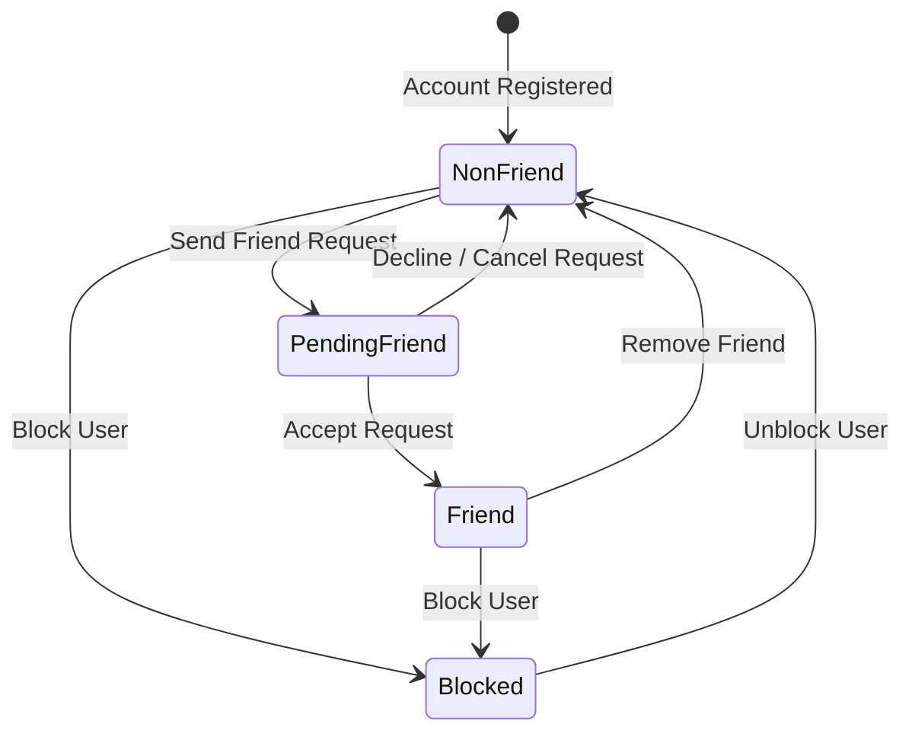

# Access Control & Permissions Matrix

## 1. Architectural Access Model

The system employs a hybrid **Role-Based Access Control (RBAC)** and **Relationship-Based Access Control (ReBAC)** architecture. 

### 1.1 Account Roles vs. Social Relationships
- **Account Roles (System-Level)**:
  1. `Visitor`: Unauthenticated guest browsing introductory information.
  2. `Learner`: Authenticated standard user engaging in study activities.
  3. `Administrator`: Privileged account responsible for community creation and content moderation.
- **Contextual Relationships (Subject-to-Subject)**:
  - *"Friend" is not an account role*; it is a bidirectional social relationship between two `Learner` accounts that selectively modulates social visibility without bypassing private history protections.
  - Key relationship contexts:
    - `Self (Owner)`: The authenticated user viewing their own assets.
    - `Friend`: Two learners with an active, mutually accepted friendship link.
    - `Accepted Partner`: Two learners bound to an active or scheduled one-to-one session.
    - `Non-Friend Learner`: Standard peer without direct friendship or session bindings.
    - `Blocked Learner`: Either learner has placed an active block on the other.

---

## 2. Field-Level Access Control Matrix

### Legend
- **`R`**: Read access permitted.
- **`W`**: Write / Create / Edit access permitted.
- **`D`**: Delete / Remove access permitted.
- **`–`**: Access denied (HTTP 401 / 403 / 404).
- **`*`**: Conditional access (governed by opt-in privacy toggles or session states).

---

### 2.1 User Profile & Identity Fields

| Profile Attribute | Visitor | Non-Friend Learner | Friend Relationship | Accepted Study Partner | Self (Owner) | Administrator |
| :--- | :-: | :-: | :-: | :-: | :-: | :-: |
| **Username & Display Name** | R | R | R | R | R, W | R |
| **Public Avatar & Bio** | R | R | R | R | R, W | R |
| **Timezone & Primary Languages** | R | R | R | R | R, W | R |
| **Topic Levels & Goal Preferences** | – | R | R | R | R, W | R |
| **Weekly Availability Slots** | – | – | R* *(if allowed)* | R *(during match)* | R, W | R |
| **Online / Presence Status** | – | – | R | R *(during session)*| R | R |
| **Public Reputation Badge Tiles** | R | R | R | R | R | R |
| **Previous Partners List** | – | –* *(opt-in)* | –* *(opt-in)* | –* *(opt-in)* | R, W | R |
| **Remaining Daily Allowance** | – | – | – | – | R | R |
| **Email Address & Account Hash** | – | – | – | – | R *(email)*, W | R *(audit only)*|
| **System Role & Account State** | – | – | – | – | R | R, W |

> **Privacy Rule**: Previous study partners are **private by default**. Only if a learner explicitly toggles `privacy_show_partners = true` in their settings are previous partner handles exposed to other learners.

---

### 2.2 Community & Channel Content

| Resource / Action | Visitor | Non-Member Learner | Channel Member | Post Author | Administrator |
| :--- | :-: | :-: | :-: | :-: | :-: |
| **Browse Community Directory** | R | R | R | R | R |
| **Create New Community** | – | – | – | – | W |
| **Create Topic Channel** | – | – | W | W | W |
| **Join / Leave Channel** | – | W | W | W | W |
| **Read Channel Posts** | – | – *(Gated)* | R | R | R |
| **Create Discussion Post** | – | – | W | W | W |
| **Edit / Delete Own Post** | – | – | – | W, D | W, D |
| **Hide / Moderate Post** | – | – | – | – | W *(Soft delete)* |
| **Give Helpful Acknowledgement** | – | – | W *(1 per post)*| – *(Excluded)* | W |

---

### 2.3 Study Listings & Matching Discovery

| Listing & Matching Action | Visitor | Non-Member Learner | Channel Member | Listing Author | Accepted Respondent |
| :--- | :-: | :-: | :-: | :-: | :-: |
| **Browse Open Listings** | – | – *(Gated)* | R | R | R |
| **Run Compatibility Ranking** | – | – *(Gated)* | R *(Calculated)*| – | R |
| **Create Study Listing** | – | – | W | W | – |
| **Edit / Delete Open Listing** | – | – | – | W, D *(If no responses)*| – |
| **Submit Response to Listing** | – | – | W *(If eligible)*| – *(Self rejected)*| – |
| **Withdraw Own Response** | – | – | – | – | D *(Before acceptance)*|
| **View Incoming Candidate List** | – | – | – | R *(With scores)*| – |
| **Accept Candidate Respondent** | – | – | – | W *(Locks session)*| – |

> **Gating Invariant**: Non-members cannot access listing feeds or submit responses. Channel membership is a mandatory precondition for both UI visibility and API route execution.

---

### 2.4 One-to-One Sessions & Real-Time Chat

| Session Resource / Action | Visitor | Non-Partner Learner | Friend Relationship | Scheduled Participant | Active Participant | Administrator |
| :--- | :-: | :-: | :-: | :-: | :-: | :-: |
| **View Scheduled Session Card** | – | – | – | R | R | R *(Audit)* |
| **Enter Session Chat Room** | – | – | – | – | R, W | – |
| **Send Session Message** | – | – | – | – | W *(During active)*| – |
| **Read Session Message History**| – | – | – | – | R *(Participant)* | R *(Report audit)* |
| **Initiate Session Start** | – | – | – | W *(Both required)*| – | – |
| **End Session Manually** | – | – | – | – | W *(Either party)* | W *(Moderation)* |
| **Submit Outcome Draft** | – | – | – | – | W *(Post-session)* | – |
| **Confirm Outcome Notes** | – | – | – | – | W *(Partner only)*| – |
| **Submit Partner Review** | – | – | – | – | W *(If $\ge 5$ min)* | – |

> **Strict Isolation Invariant**: Friendship does **not** grant permission to observe, eavesdrop on, or access session rooms or chat logs of other learners.

---

### 2.5 Study History, Ledgers & Moderation

| Resource / Function | Visitor | Non-Friend Learner | Friend Relationship | Account Owner | Administrator |
| :--- | :-: | :-: | :-: | :-: | :-: |
| **Detailed Session History** | – | – | – | R | R *(Support)* |
| **Usage Ledger (Counted Minutes)**| – | – | – | R | R |
| **Submit User Abuse Report** | – | W | W | – | R *(Queue)* |
| **Place Account Block** | – | W | W | – | – |
| **Suspend / Restrict Account** | – | – | – | – | W |

---

## 3. Relationship Transition Rules

1. **Friendship Invariants**:
   - Friend requests cannot be sent to oneself or to a blocked user.
   - Removing a friend severs social presence visibility immediately without affecting past confirmed study outcomes.
2. **Blocking Invariants**:
   - An active block between Learner A and Learner B immediately:
     1. Suppresses all listings authored by A from B's discovery feeds (and vice versa).
     2. Disables response submissions between the pair.
     3. Dissolves existing friendship connections.
     4. Prevents direct messaging in any context outside historical locked archives.
