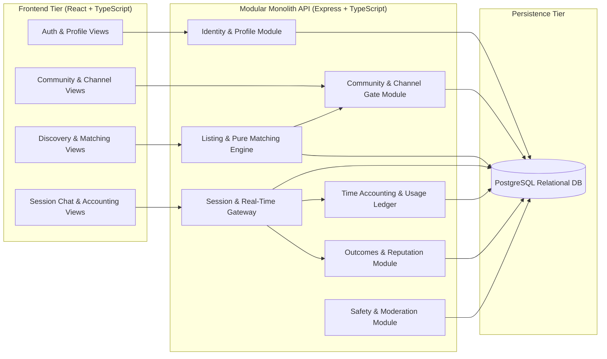

# System Architecture & Technical Design

## 1. Architectural Style & Principles

The **Compatibility-Based Peer Learning Platform** is designed as a **Modular Monolith**. This pattern combines high deployment simplicity with rigorous internal domain decoupling, perfectly aligning with the engineering scale of an individual diploma project while avoiding the operational, network, and consistency overhead of distributed microservices.

```mermaid
flowchart TD
    subgraph Users["Platform Actors"]
        L["Learner (Account Role)"]
        A["Administrator (Account Role)"]
        V["Visitor (Unauthenticated)"]
    end

    subgraph Boundaries["System Context Boundary"]
        subgraph Platform["Compatibility-Based Peer Learning Platform"]
            FE["Web Client (React + TypeScript)"]
            API["Modular Monolith Backend (Node.js / Express + TypeScript)"]
            WS["WebSocket Real-Time Gateway (ws)"]
            DB[("Relational Database (PostgreSQL)")]
        end
    end

    V -->|Browse Public Overview / Register| FE
    L -->|Context: Listing Author / Respondent / Partner| FE
    A -->|Manage Communities & Review Reports| FE

    FE <-->|REST API (HTTPS / JSON)| API
    FE <-->|Bidirectional Session Sync & Chat| WS
    API <-->|SQL Queries & Transactions| DB
    WS <-->|Session State Verification & Persistence| DB
    WS <-->|Internal Event Bridge| API
```

### 1.1 Core Architectural Principles
1. **Strict Dependency Bounding**: The architecture relies solely on self-contained first-party modules and a PostgreSQL relational database. Future monetization, payment processors, and heavy third-party video conferencing services are **formally excluded** from system boundaries and dependencies.
2. **Deterministic & Pure Compatibility Engine**: The matching algorithm is decoupled from side effects and database state. It operates as a pure, versioned mathematical function taking explicit learner and listing vectors as inputs and yielding an auditable numerical score and explanatory breakdown.
3. **Server-Authoritative Time & State**: Clients act as passive mirrors. Time accounting, session termination, and daily allowances are computed, validated, and persisted exclusively on the server.
4. **Contextual Role Modeling**: System account types are restricted to `Visitor`, `Learner`, and `Administrator`. `Listing Author` and `Respondent` are modeled as **contextual learner roles** assumed within the lifecycle of a study listing, not distinct account categories.

---

## 2. System Context & Boundaries

### 2.1 Actors
- **Visitor**: Unauthenticated user accessing the platform landing page, community directory preview, and authentication endpoints (registration, login).
- **Learner**: Authenticated user managing their learning preferences, joining topic channels, publishing study listings, responding to open requests, engaging in 1-to-1 session text chat, and reviewing peers.
  - *Contextual Role: Listing Author*: Learner who initiates a study request, configures parameters, and selects exactly one respondent.
  - *Contextual Role: Respondent*: Learner who submits an application to join an open listing.
  - *Contextual Role: Session Participant*: Both matched learners engaged in an active or completed study session.
- **Administrator**: Privileged user managing high-level communities, reviewing moderation abuse reports, and enforcing account suspensions.

### 2.2 System Context Invariants
- **No External Media Streaming**: Communication during study sessions occurs strictly via in-platform synchronous text chat with monotonic server time tracking.
- **No Financial / Payment Gateways**: The platform operates as a free educational exchange; no billing or wallet integrations exist.

---

## 3. Modular Monolith Subsystem Breakdown

The backend service is structured into cohesive domain modules with explicit interfaces:



### 3.1 Module Responsibilities

1. **Identity & Profile Module (`/auth`, `/users`)**:
   - Manages user accounts, bcrypt password hashing, and session tokens.
   - Manages topic-specific knowledge levels, normalized goals, spoken languages, and dated availability intervals.
   - Enforces field-level access control (FR-01, FR-02, FR-15).
2. **Community & Content Gate Module (`/communities`, `/channels`, `/posts`)**:
   - Organizes communities and topic channels.
   - Enforces **Channel Membership Gating**: Rejects unauthorized access to channel listings, discussions, and discovery (FR-03, FR-04).
   - Manages channel discussion posts (`question`, `explanation`, `material`, `progress`) and single helpful acknowledgements (FR-05).
3. **Listing & Compatibility Matching Engine (`/listings`, `/discovery`)**:
   - Manages study listing creation, validation, and lifecycle (`open`, `matched`, `closed`, `cancelled`).
   - Implements the pure compatibility function:
     $$\text{Score} = 100(0.40T + 0.35G + 0.25L)$$
   - Executes hard eligibility filtering (language, time availability, safety blocking) (FR-06, FR-07).
4. **Session & Real-Time Gateway (`/sessions`, `/ws`)**:
   - Coordinates the one-to-one session lifecycle (`scheduled → active → ended/cancelled/no_show`).
   - Authenticates WebSocket connections and guarantees message isolation between accepted participants (FR-10).
   - Handles the 60-second disconnection grace period (FR-17).
   - Enforces exact terminal reasons: `manual_exit`, `scheduled_end`, `allowance_exhaustion`, `connection_interruption`, `blocked`.
5. **Time Accounting & Usage Ledger Module (`/accounting`)**:
   - Server-authoritative tracking of active session duration in integer seconds.
   - Manages the **180-minute daily study allowance** (10,800 integer seconds) per learner (Confirmed).
   - Enforces UTC day boundaries (`00:00–24:00 UTC`) and splits cross-midnight usage atomically without display rounding affecting ledger state (FR-11).
6. **Outcomes & Reputation Module (`/outcomes`, `/reviews`)**:
   - Recording session outcomes is Confirmed. Requiring both participants to confirm the same outcome version is Proposed. If implemented, mutual confirmation follows FR-12’s version-safe protocol (`version`, `last_editor_id`, `approved_version_a`, `approved_version_b`) and contributes to reputation only under the separately proposed eligibility rules.
   - Manages single partner review submissions for sessions $\ge 300\text{ accounted seconds}$ (FR-13).
   - Aggregates decomposed reputation metrics (completed sessions, total hours, average rating, confirmed topics) (FR-19).
7. **Safety & Moderation Module (`/safety`, `/moderation`)**:
   - Manages bidirectional user blocks, suppressing discovery and communication.
   - Cancels scheduled sessions, terminates active sessions with reason `blocked`, preserves participant read-only archives, and disables new outcome edits between blocked learners.
   - Queues and processes abuse reports for administrative resolution (FR-16).

---

## 4. Transactional Boundaries & Concurrency Controls

To satisfy data integrity requirements (NFR-02), two critical database workflows require atomic isolation:

### 4.1 Participant locking and atomic acceptance

**Classification: Proposed implementation design.**

A listing lock prevents two acceptances of the same listing. Preventing overlapping bookings across different listings additionally requires serialization on the participating learners.

#### Shared lock protocol

All operations that create, release, or change bookings must use the following protocol:

1. Read resource identifiers to discover the affected participants. This preliminary read grants no authorization and makes no final eligibility decision.
2. Begin a database transaction.
3. Lock the affected `users` rows using `SELECT … FOR UPDATE`, acquiring them individually in ascending UUID order.
4. Acquire any additional required locks in this order:
   - `study_listings`, ascending ID;
   - `listing_responses`, ascending ID;
   - `study_sessions`, ascending ID;
   - `session_outcomes`, ascending ID.
5. Re-read and validate the affected resources after locking.
6. Perform the state changes and commit.

Only lock classes required by the operation are acquired. No operation may acquire an earlier lock class after acquiring a later one. Do not perform network calls while holding these locks.

Participant identities on existing listings, responses, and sessions are immutable. Derive the respondent from the response record, not from an independently supplied respondent ID.

All booking creation paths must acquire participant locks. The same protocol applies to acceptance, withdrawal/re-response, blocking, cancellation, session start, and finalization. Membership and availability changes must acquire the changing learner’s user-row lock so that acceptance observes a consistent ordering relative to those changes.

#### Acceptance-time checks

After locking both participants, the listing, and its relevant responses, verify:

- The authenticated actor is the listing author.
- The listing is `open` and its start is still in the future.
- The chosen response belongs to this listing and remains `pending`.
- The respondent differs from the author.
- Both accounts are permitted to participate.
- Both learners remain channel members.
- Neither learner has blocked the other.
- The listing language remains declared by both participants.
- The respondent’s dated availability covers the complete listing interval. The author’s listing is their explicit availability declaration for that interval.
- Neither participant has a `scheduled` or `active` session whose reserved interval overlaps the proposed interval.

Use half-open intervals `[start, end)`. Compare `TIMESTAMPTZ` values using equivalent timezone-aware interval logic, such as `tstzrange`.

Then atomically:

1. Set the listing to `matched`.
2. Set the selected response to `accepted`.
3. Set other pending responses to `declined`.
4. Create one `scheduled` session containing the immutable participant IDs and scheduled interval.

Retain `UNIQUE(study_sessions.listing_id)` as an additional integrity constraint. A schedule-conflict check without participant locking does not satisfy this specification.

#### Withdrawal and re-response

Withdrawal acquires locks for the listing author and respondent, then the listing and response.

- `pending → withdrawn` is permitted.
- Repeated withdrawal of an already withdrawn response returns its existing state.
- Withdrawal after acceptance returns a state-conflict response; cancelling the resulting scheduled session is a separate action.
- Re-response changes the same response row from `withdrawn → pending`, after checking that the listing remains open and eligibility still holds.
- Re-response never creates a second row for the same listing–respondent pair.

Acceptance and withdrawal therefore serialize:

- If withdrawal commits first, acceptance rejects the withdrawn response.
- If acceptance commits first, withdrawal rejects the accepted response.

#### Blocking

Blocking acquires both users’ locks in ascending order before changing the relationship.

Within the same transaction, it:

- Creates the directional block if absent.
- Withdraws pending responses between the pair.
- Removes their friendship relationship.
- Cancels scheduled sessions between the pair.
- Finalizes active sessions between the pair using the accounting rules.
- Prevents subsequent acceptance, responses, friendship requests, and session messages between them.

Acquire affected listing, response, and session locks in the shared order.

If acceptance commits before blocking, blocking cancels the newly scheduled session. If blocking commits first, acceptance fails its block check. Neither ordering leaves a usable booking between blocked participants.

### Acceptance fixtures

| ID | Scenario | Expected result |
| --- | --- | --- |
| **C-01: Cross-listing race** | A accepts P on listing X, 14:00–15:00. Simultaneously B accepts P on listing Y, 14:30–15:30. | Both transactions require P’s user-row lock. One commits; the other subsequently detects the committed overlap and returns `409 SCHEDULE_CONFLICT`. Exactly one booking exists. |
| **C-02: Back-to-back bookings** | Same participants are booked 14:00–15:00 and 15:00–16:00. | No overlap solely from the shared endpoint. |
| **C-03: Withdrawal race** | Author accepts while respondent withdraws. | One serial ordering applies. A response cannot finish as withdrawn while its acceptance simultaneously creates a valid session. |
| **C-04: Block race** | Author accepts while either party blocks the other. | Acceptance either fails, or its resulting scheduled session is cancelled by the block transaction. No usable shared booking survives. |

### 4.2 Canonical session finalization reference

Session finalization uses the canonical algorithm in `session-lifecycle.md` §§3 and 5. It acquires participant locks before the session lock, computes the effective end, splits integer-second usage by UTC day, and commits session and ledger changes atomically. No separate finalization algorithm is maintained here.

---

## 5. Security Architecture & Boundary Invariants

1. **Authentication**: Stateless JSON Web Tokens (JWT) or secure HTTP-only cookies containing user ID, role, and token version.
2. **Access Control**: Every incoming API request passes through the RBAC / ReBAC authorization middleware validating:
   - Route role requirements (`learner`, `admin`).
   - Contextual ownership (`user_id == req.user.id`).
   - Channel membership status (`channel_memberships` verification).
   - Relationship blocks (`user_blocks` check).
3. **Session Chat Isolation**: WebSocket connections must present a valid session token. Sockets join channel rooms named `session:{session_id}`; emissions are confined strictly to verified participants.
