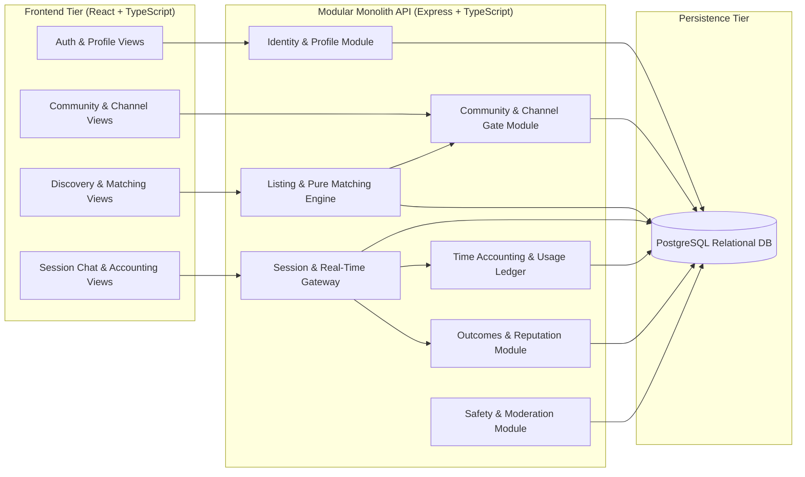

# System Architecture & Technical Design

## 1. Architectural Style & Principles

The **Compatibility-Based Peer Learning Platform** is designed as a **Modular Monolith**. This pattern combines high deployment simplicity with rigorous internal domain decoupling, perfectly aligning with the engineering scale of an individual diploma project while avoiding the operational, network, and consistency overhead of distributed microservices.

```mermaid
flowchart TD
    subgraph Users["Platform Actors"]
        L["Learner (Account Role)"]
        A["Administrator (Account Role)"]
        V["Visitor (Unauthenticated)"]
    end

    subgraph Boundaries["System Context Boundary"]
        subgraph Platform["Compatibility-Based Peer Learning Platform"]
            FE["Web Client (React + TypeScript)"]
            API["Modular Monolith Backend (Node.js / Express + TypeScript)"]
            WS["WebSocket Real-Time Gateway (ws)"]
            DB[("Relational Database (PostgreSQL)")]
        end
    end

    V -->|Browse Public Overview / Register| FE
    L -->|Context: Listing Author / Respondent / Partner| FE
    A -->|Manage Communities & Review Reports| FE

    FE <-->|REST API (HTTPS / JSON)| API
    FE <-->|Bidirectional Session Sync & Chat| WS
    API <-->|SQL Queries & Transactions| DB
    WS <-->|Session State Verification & Persistence| DB
    WS <-->|Internal Event Bridge| API
```

### 1.1 Core Architectural Principles
1. **Strict Dependency Bounding**: The architecture relies solely on self-contained first-party modules and a PostgreSQL relational database. Future monetization, payment processors, and heavy third-party video conferencing services are **formally excluded** from system boundaries and dependencies.
2. **Deterministic & Pure Compatibility Engine**: The matching algorithm is decoupled from side effects and database state. It operates as a pure, versioned mathematical function taking explicit learner and listing vectors as inputs and yielding an auditable numerical score and explanatory breakdown.
3. **Server-Authoritative Time & State**: Clients act as passive mirrors. Time accounting, session termination, and daily allowances are computed, validated, and persisted exclusively on the server.
4. **Contextual Role Modeling**: System account types are restricted to `Visitor`, `Learner`, and `Administrator`. `Listing Author` and `Respondent` are modeled as **contextual learner roles** assumed within the lifecycle of a study listing, not distinct account categories.

---

## 2. System Context & Boundaries

### 2.1 Actors
- **Visitor**: Unauthenticated user accessing the platform landing page, community directory preview, and authentication endpoints (registration, login).
- **Learner**: Authenticated user managing their learning preferences, joining topic channels, publishing study listings, responding to open requests, engaging in 1-to-1 session text chat, and reviewing peers.
  - *Contextual Role: Listing Author*: Learner who initiates a study request, configures parameters, and selects exactly one respondent.
  - *Contextual Role: Respondent*: Learner who submits an application to join an open listing.
  - *Contextual Role: Session Participant*: Both matched learners engaged in an active or completed study session.
- **Administrator**: Privileged user managing high-level communities, reviewing moderation abuse reports, and enforcing account suspensions.

### 2.2 System Context Invariants
- **No External Media Streaming**: Communication during study sessions occurs strictly via in-platform synchronous text chat with monotonic server time tracking.
- **No Financial / Payment Gateways**: The platform operates as a free educational exchange; no billing or wallet integrations exist.

---

## 3. Modular Monolith Subsystem Breakdown

The backend service is structured into cohesive domain modules with explicit interfaces:



### 3.1 Module Responsibilities

1. **Identity & Profile Module (`/auth`, `/users`)**:
   - Manages user accounts, bcrypt password hashing, and session tokens.
   - Manages topic-specific knowledge levels, normalized goals, spoken languages, and weekly availability intervals.
   - Enforces field-level access control (FR-01, FR-02, FR-15).
2. **Community & Content Gate Module (`/communities`, `/channels`, `/posts`)**:
   - Organizes communities and topic channels.
   - Enforces **Channel Membership Gating**: Rejects unauthorized access to channel listings, discussions, and discovery (FR-03, FR-04).
   - Manages channel discussion posts (`question`, `explanation`, `material`, `progress`) and single helpful acknowledgements (FR-05).
3. **Listing & Compatibility Matching Engine (`/listings`, `/discovery`)**:
   - Manages study listing creation, validation, and lifecycle (`open`, `matched`, `closed`, `cancelled`).
   - Implements the pure compatibility function:
     $$\text{Score} = 100(0.40T + 0.35G + 0.25L)$$
   - Executes hard eligibility filtering (language, time availability, safety blocking) (FR-06, FR-07).
4. **Session & Real-Time Gateway (`/sessions`, `/ws`)**:
   - Coordinates the one-to-one session lifecycle (`scheduled → active → ended/cancelled/no_show`).
   - Authenticates WebSocket connections and guarantees message isolation between accepted participants (FR-10).
   - Handles the 60-second disconnection grace period (FR-17).
5. **Time Accounting & Usage Ledger Module (`/accounting`)**:
   - Server-authoritative tracking of active session duration.
   - Manages the **180-minute daily study allowance** per learner (Confirmed).
   - Enforces UTC day boundaries (`00:00–24:00 UTC`) and splits cross-midnight usage atomically (FR-11).
6. **Outcomes & Reputation Module (`/outcomes`, `/reviews`)**:
   - Manages post-session dual outcome confirmation: notes become confirmed outcomes only when both learners approve identical text (FR-12).
   - Manages single partner review submissions for sessions $\ge 5\text{ accounted minutes}$ (FR-13).
   - Aggregates decomposed reputation metrics (completed sessions, total hours, average rating, confirmed topics) (FR-19).
7. **Safety & Moderation Module (`/safety`, `/moderation`)**:
   - Manages bidirectional user blocks, suppressing discovery and communication.
   - Queues and processes abuse reports for administrative resolution (FR-16).

---

## 4. Transactional Boundaries & Concurrency Controls

To satisfy data integrity requirements (NFR-02), two critical database workflows require atomic isolation:

### 4.1 Concurrent Listing Acceptance Workflow
When a listing author accepts a respondent, concurrent acceptance requests must be serialized to prevent double-booking or duplicate sessions:
```sql
-- Specification Pseudocode (Atomic Acceptance Routine)
BEGIN TRANSACTION ISOLATION LEVEL READ COMMITTED;

  -- 1. Acquire exclusive row-level lock on the listing
  SELECT id, status, author_id, channel_id, scheduled_start_time, duration_minutes 
  FROM study_listings 
  WHERE id = :listing_id FOR UPDATE;

  -- 2. Verify listing is still open
  IF study_listings.status != 'open' THEN
    ROLLBACK;
    RAISE EXCEPTION 'Listing is no longer open for acceptance';
  END IF;

  -- 3. Verify respondent has pending response and neither party has blocked the other
  PERFORM 1 FROM listing_responses lr
  WHERE lr.id = :response_id AND lr.listing_id = :listing_id AND lr.status = 'pending'
    AND NOT EXISTS (
      SELECT 1 FROM user_blocks ub 
      WHERE (ub.blocker_id = study_listings.author_id AND ub.blocked_id = lr.respondent_id)
         OR (ub.blocker_id = lr.respondent_id AND ub.blocked_id = study_listings.author_id)
    );
  IF NOT FOUND THEN
    ROLLBACK;
    RAISE EXCEPTION 'Respondent response is invalid or communication is blocked';
  END IF;

  -- 4. Verify neither participant has conflicting accepted sessions across any listing
  PERFORM 1 FROM study_sessions s
  WHERE (s.user_a_id IN (study_listings.author_id, :respondent_id) OR s.user_b_id IN (study_listings.author_id, :respondent_id))
    AND s.status IN ('scheduled', 'active')
    AND tsrange(s.scheduled_start_time, s.scheduled_start_time + (s.duration_minutes * INTERVAL '1 minute')) &&
        tsrange(study_listings.scheduled_start_time, study_listings.scheduled_start_time + (study_listings.duration_minutes * INTERVAL '1 minute'));
  IF FOUND THEN
    ROLLBACK;
    RAISE EXCEPTION 'Schedule collision detected for one of the participants';
  END IF;

  -- 5. Transition listing status
  UPDATE study_listings SET status = 'matched' WHERE id = :listing_id;

  -- 6. Mark accepted response
  UPDATE listing_responses SET status = 'accepted' WHERE id = :response_id;

  -- 7. Automatically decline all other candidate responses
  UPDATE listing_responses 
  SET status = 'declined' 
  WHERE listing_id = :listing_id AND id != :response_id AND status = 'pending';

  -- 8. Initialize scheduled session
  INSERT INTO study_sessions (listing_id, user_a_id, user_b_id, status, scheduled_start_time, duration_minutes)
  VALUES (:listing_id, study_listings.author_id, :respondent_id, 'scheduled', study_listings.scheduled_start_time, study_listings.duration_minutes);

COMMIT;
```

### 4.2 Idempotent Session Finalization Workflow
When an active session ends, the finalization routine ensures counted minutes are inserted exactly once into `usage_ledgers`:
```sql
BEGIN TRANSACTION ISOLATION LEVEL READ COMMITTED;

  -- Lock session record
  SELECT id, status FROM study_sessions WHERE id = :session_id FOR UPDATE;

  IF study_sessions.status = 'active' THEN
    -- Finalize session record
    UPDATE study_sessions 
    SET status = 'ended', 
        ended_at = :ended_at,
        counted_duration_seconds = :counted_seconds,
        end_reason = :end_reason
    WHERE id = :session_id;

    -- Apportion minutes to usage ledger by UTC date
    INSERT INTO usage_ledgers (session_id, user_id, utc_date, counted_minutes)
    VALUES 
      (:session_id, :user_a_id, :utc_date, :counted_minutes),
      (:session_id, :user_b_id, :utc_date, :counted_minutes);
  END IF;

COMMIT;
```

---

## 5. Security Architecture & Boundary Invariants

1. **Authentication**: Stateless JSON Web Tokens (JWT) or secure HTTP-only cookies containing user ID, role, and token version.
2. **Access Control**: Every incoming API request passes through the RBAC / ReBAC authorization middleware validating:
   - Route role requirements (`learner`, `admin`).
   - Contextual ownership (`user_id == req.user.id`).
   - Channel membership status (`channel_memberships` verification).
   - Relationship blocks (`user_blocks` check).
3. **Session Chat Isolation**: WebSocket connections must present a valid session token. Sockets join channel rooms named `session:{session_id}`; emissions are confined strictly to verified participants.
