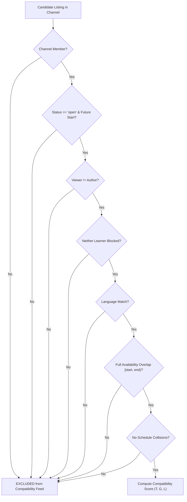

# Explainable Learner Compatibility & Matching Rules

## 1. Mathematical Formulation & Design Philosophy

### 1.1 Compatibility Model Overview
The platform employs a **deterministic, auditable, and explainable multi-attribute scoring model** rather than an opaque machine-learning model. This choice is an engineering decision suited for small early datasets and full user transparency: each recommendation can be inspected and understood directly by learners.

$$\text{Score} = 100 \times \Big( 0.40 \cdot T + 0.35 \cdot G + 0.25 \cdot L \Big)$$

> **Design Rule Classification**: The weights ($0.40, 0.35, 0.25$), normalized goal categories, and 3-tier level descriptors are **Proposed starting hypotheses** for empirical testing, not validated psychological or pedagogical constants.

### 1.2 Score Display & Rounding Convention
- Compatibility scores are expressed as points out of 100 (e.g., `Compatibility Score: 67.5 / 100`), **not as percentages** (e.g., avoid `67.5%`), to prevent users from misinterpreting the score as a statistical probability of session success.
- Scores are computed using double-precision floating-point arithmetic and rounded to **one decimal place** for user display.

---

## 2. Hard Eligibility Conditions (Pre-Scoring Filtering)

A study listing is evaluated by the compatibility scoring engine **only if** it satisfies all seven hard eligibility conditions. If any condition fails, the listing is excluded from the compatibility feed.

### 2.1 Eligibility Invariants
1. **Channel Membership Gate**: The viewing learner must be a member of the topic channel hosting the listing.
2. **Temporal Validity**: Listing status must be `open`, and `scheduled_start_time > current_server_time_utc`.
3. **Self-Exclusion**: A learner cannot match with or respond to their own listing (`viewer_id != author_id`).
4. **Safety & Blocking**: Neither learner has placed an active block on the other (`user_blocks` check).
5. **Language Match**: The listing's designated language must be included in the viewing learner's declared spoken languages array.
6. **Full Availability Overlap (Half-Open Intervals)**: The listing's scheduled interval must be completely enclosed within the viewing learner's declared availability. Intervals are modeled as **half-open $[t_{\text{start}}, t_{\text{end}})$**:
   $$[t_{\text{start}}, t_{\text{start}} + \text{duration}) \subseteq \text{Availability}_{\text{viewer}}$$
   *Half-open intervals guarantee that adjacent back-to-back sessions (e.g., 14:00–15:00 and 15:00–16:00) do not create false collision errors.*
7. **No Schedule Collision**: Neither the listing author nor the viewer has an accepted session overlapping $[t_{\text{start}}, t_{\text{start}} + \text{duration})$.

### 2.2 Controlled Evaluation Consistency Rule
To evaluate the true effect of compatibility ranking versus chronological ordering (RQ1):
- **Identical Eligibility Rule**: In empirical testing, both the **Chronological (Baseline)** condition and the **Compatibility (Experimental)** condition must apply the **exact same hard eligibility filters** (Conditions 1–7 above).
- The only independent variable between conditions is the **ordering** of eligible listings:
  - *Chronological Condition*: Eligible listings sorted by `created_at DESC` (or `scheduled_start_time ASC`).
  - *Compatibility Condition*: Eligible listings sorted by `Score DESC`.
- **Broader Browsing**: Browsing listings with relaxed language or schedule filters is a separate, user-initiated exploration mode and must not be conflated with the baseline chronological evaluation.

---

## 3. Factor Computation ($T, G, L$)

### 3.1 Required Inputs for Ranking
Compatibility ranking requires valid input vectors from both parties:
- **Viewer Inputs**: Selected topic preference tags ($V_{\text{topics}}$), topic-specific knowledge level ($\text{Level}_{\text{viewer}}$), and declared study goal category ($\text{Category}_{\text{viewer}}$).
- **Listing Inputs**: Topic tags ($L_{\text{topics}} \ge 1$), author knowledge level ($\text{Level}_{\text{author}}$), and target goal category ($\text{Category}_{\text{listing}}$).

#### Missing Preference Handling
- If a viewing learner has **not configured** their topic preference tags, knowledge level, or goal category:
  - **No invented or default scores are computed** (e.g., setting $T=0.50$ is prohibited).
  - Compatibility ranking is disabled for that query.
  - The UI presents an inline advisory: *"Complete your study preferences for this topic to unlock compatibility scores."*
  - The listing feed falls back gracefully to standard chronological ordering.

---

### 3.2 Topic Fit ($T$)
Topic fit measures sub-concept overlap within the parent channel using the Jaccard similarity coefficient:
$$T = \frac{|V_{\text{topics}} \cap L_{\text{topics}}|}{|V_{\text{topics}} \cup L_{\text{topics}}|}$$
- Where $V_{\text{topics}}$ is the non-empty set of viewer preference tags, and $L_{\text{topics}}$ is the non-empty set of listing tags.
- Range: $T \in [0.0, 1.0]$.
- Listings require at least one structured tag upon creation.

---

### 3.3 Goal Fit ($G$)
Goal fit evaluates pedagogical alignment based on four normalized categories:
1. `understanding_concept`: Foundational concepts, syntax debugging, theory.
2. `practicing_exercises`: Solving algorithm problems, conversation practice, drills.
3. `preparing_assessment`: Exam revision, mock technical interview, quiz review.
4. `completing_project`: Pair programming on coursework, portfolio projects.

$$G = \begin{cases} 
1.0 & \text{if } \text{Category}_{\text{viewer}} = \text{Category}_{\text{listing}} \\ 
0.0 & \text{if } \text{Category}_{\text{viewer}} \ne \text{Category}_{\text{listing}} 
\end{cases}$$

---

### 3.4 Level Fit ($L$)
Topic knowledge levels are self-reported on a 3-tier scale (1: Beginner, 2: Intermediate, 3: Advanced):
$$L = \begin{cases} 
1.0 & \text{if } |\text{Level}_{\text{viewer}} - \text{Level}_{\text{listing}}| = 0 \quad (\text{Exact match}) \\ 
0.5 & \text{if } |\text{Level}_{\text{viewer}} - \text{Level}_{\text{listing}}| = 1 \quad (\text{Adjacent level}) \\ 
0.0 & \text{if } |\text{Level}_{\text{viewer}} - \text{Level}_{\text{listing}}| \ge 2 \quad (\text{Two levels apart}) 
\end{cases}$$

> **Conceptual Framing**: Adjacent-level scoring ($L=0.5$) is an engineering design choice inspired by Vygotskian peer-scaffolding concepts (Zone of Proximal Development). The numerical score ($0.5$) is a working hypothesis to be validated or refined through user feedback.

---

## 4. Concrete Arithmetic Fixtures & Examples

The following deterministic test fixtures govern calculation and display:

### Fixture A: Perfect Multi-Attribute Match
- **Inputs**: $V_{\text{topics}} = \{\text{asyncio, fastapi}\}$, $L_{\text{topics}} = \{\text{asyncio, fastapi}\}$; identical goal (`completing_project`); both Level 2 (Intermediate).
- **Factor Values**: $T = \frac{2}{2} = 1.0$, $G = 1.0$, $L = 1.0$.
- **Calculation**:
  $$\text{Score} = 100 \times (0.40 \cdot 1.0 + 0.35 \cdot 1.0 + 0.25 \cdot 1.0) = 100 \times 1.0 = 100.0$$
- **UI Output**: `Compatibility Score: 100.0 / 100`
- **Explanation**: *"Identical topic focus, shared study goal, same knowledge level, shared language, full schedule overlap."*

### Fixture B: Partial Topic & Adjacent Level with Shared Goal
- **Inputs**: $V_{\text{topics}} = \{\text{derivatives, limits}\}$, $L_{\text{topics}} = \{\text{derivatives, integrals}\}$; identical goal (`practicing_exercises`); viewer Level 1 (Beginner), author Level 2 (Intermediate).
- **Factor Values**: $T = \frac{|\{\text{derivatives}\}|}{|\{\text{derivatives, limits, integrals}\}|} = \frac{1}{3} \approx 0.3333$, $G = 1.0$, $L = 0.5$ (adjacent).
- **Calculation**:
  $$\text{Score} = 100 \times \Big( 0.40 \cdot \frac{1}{3} + 0.35 \cdot 1.0 + 0.25 \cdot 0.5 \Big) = 100 \times (0.1333 + 0.3500 + 0.1250) = 60.8333... \approx 60.8$$
- **UI Output**: `Compatibility Score: 60.8 / 100`
- **Explanation**: *"Overlapping topic tags, shared study goal, adjacent knowledge level, shared language, full schedule overlap."*

### Fixture C: Half Topic Overlap, Different Goal, Adjacent Level
- **Inputs**: $T = 0.50$, $G = 0.0$ (different goal categories), $L = 0.5$ (adjacent level).
- **Calculation**:
  $$\text{Score} = 100 \times (0.40 \cdot 0.50 + 0.35 \cdot 0.0 + 0.25 \cdot 0.50) = 100 \times (0.2000 + 0.0000 + 0.1250) = 32.5$$
- **UI Output**: `Compatibility Score: 32.5 / 100`
- **Explanation**: *"Overlapping topic tags, different study goal, adjacent knowledge level, shared language, full schedule overlap."*

### Fixture D: Disparate Level, Different Goal, Low Topic Overlap
- **Inputs**: $T = 0.25$, $G = 0.0$, $L = 0.0$ (two levels apart: Beginner vs. Advanced).
- **Calculation**:
  $$\text{Score} = 100 \times (0.40 \cdot 0.25 + 0.35 \cdot 0.0 + 0.25 \cdot 0.0) = 100 \times 0.1000 = 10.0$$
- **UI Output**: `Compatibility Score: 10.0 / 100`
- **Explanation**: *"Partial topic overlap, different study goal, different knowledge level, shared language, full schedule overlap."*

---

## 5. Edge-Case Resolution Matrix

| Edge Case | Specification Rule | Observable Behavior |
| :--- | :--- | :--- |
| **Missing Preferences** | Scoring disabled; no invented or default values allowed. | UI suppresses score column, displays inline prompt to complete preferences, and orders listings chronologically. |
| **Zero Matches** | Filtering criteria strictly preserved; no silent relaxation. | UI displays: *"No listings match your current filters (Language: X, Schedule: Y)."* Options provided to explicitly broaden search. |
| **Partial Time Overlap** | Strict compatibility excludes partial overlap. | In broad browse mode, rendered with warning badge: *"Partial Time Overlap (Only 20 of 45 min)"*. |
| **Tie-Breaking** | Deterministic secondary sort. | Equal scores ordered by earliest `scheduled_start_time ASC`, then stable alphanumeric `id ASC`. |
| **Post-Response Editing** | Listing parameter immutability. | Once a response is submitted, core listing fields (`topic`, `goal`, `level`, `start_time`, `duration`, `language`) are locked against modification. Author must cancel listing to alter parameters. |
| **Repeated Partners** | Algorithmic neutrality. | Accumulated reviews or prior sessions do not boost compatibility score, preventing favoritism. |
