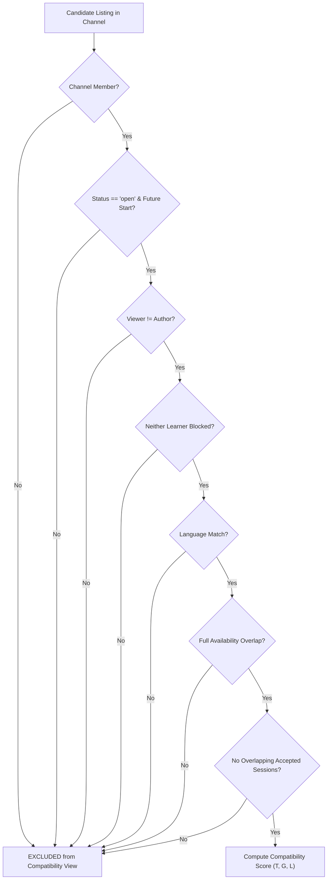

# Explainable Learner Compatibility & Matching Rules

## 1. Mathematical Formulation & Philosophy

### 1.1 Compatibility Model Overview
The platform rejects black-box machine learning and opaque psychometric heuristics in favor of a **deterministic, auditable, and explainable multi-attribute scoring model**. Compatibility reflects the alignment of concrete study attributes between two learners within a specific subject domain.

$$\text{Score} = 100 \times \Big( 0.40 \cdot T + 0.35 \cdot G + 0.25 \cdot L \Big)$$

> **Design Rule Classification**: The weights ($0.40, 0.35, 0.25$), normalized goal categories, and 3-tier level descriptors are **Proposed starting hypotheses**, established for transparent validation during empirical user testing.

---

## 2. Hard Eligibility Conditions (Pre-Scoring Gating)

A study listing is evaluated by the scoring engine **only if** it satisfies all seven hard eligibility conditions. If any condition fails, the listing is excluded from the compatibility view:



### 2.1 Hard Eligibility Criteria
1. **Channel Membership**: The viewer must be an active member of the channel hosting the listing (FR-04).
2. **Temporal Validity**: Listing status must be `open`, and `scheduled_start_time > current_server_time_utc`.
3. **Self-Exclusion**: A learner cannot match with or respond to their own listing (`viewer_id != author_id`).
4. **Safety & Blocking**: Neither learner has an active block entry against the other (`user_blocks` check).
5. **Language Overlap**: The listing's designated language must exist in the viewer's declared spoken languages array.
6. **Full Temporal Overlap**: The viewer's registered weekly availability slots must **completely cover** the scheduled session window:
   $$[\text{start}_{\text{listing}}, \text{start}_{\text{listing}} + \text{duration}_{\text{listing}}] \subseteq \text{Availability}_{\text{viewer}}$$
7. **No Schedule Collision**: Neither the listing author nor the viewer has an already accepted session overlapping that time interval.

> **Rationale**: Language proficiency and meeting time are non-negotiable logistical gates, not bonus points. A perfect topic match cannot compensate for an impossible meeting time or a language barrier.

---

## 3. Factor Computation ($T, G, L$)

### 3.1 Topic Fit ($T$)
The topic fit measures keyword and sub-concept overlap within the parent channel domain using the Jaccard similarity coefficient:
$$T = \frac{|V_{\text{topics}} \cap L_{\text{topics}}|}{|V_{\text{topics}} \cup L_{\text{topics}}|}$$
Where:
- $V_{\text{topics}}$ is the set of topic tags selected by the viewing learner.
- $L_{\text{topics}}$ is the set of topic tags specified on the study listing.

#### Handling Empty Topic Tags
- **Rule**: Study listings require at least one structured topic tag upon creation (FR-06).
- If a viewing learner browses without selecting preferred topic tags, $T$ is assigned a neutral baseline score:
  $$T = 0.50 \quad \text{(with UI notice: 'General topic match within channel')}$$

---

### 3.2 Goal Fit ($G$)
Goal fit evaluates pedagogical alignment based on four standardized learning goal categories:
1. `understanding_concept`: Foundational theory, debugging difficult syntax, or conceptual explanations.
2. `practicing_exercises`: Solving algorithm problems, conversational drills, or textbook exercises.
3. `preparing_assessment`: Exam revision, mock technical interview, or quiz preparation.
4. `completing_project`: Pair programming on a portfolio project or practical coursework assignment.

#### Goal Fit Calculation
$$G = \begin{cases} 
1.0 & \text{if } \text{Category}_{\text{viewer}} = \text{Category}_{\text{listing}} \\ 
0.0 & \text{if } \text{Category}_{\text{viewer}} \ne \text{Category}_{\text{listing}} 
\end{cases}$$

> **Note**: Specific textual goal details (e.g., *"Focusing on binary tree traversals"*) remain prominently visible in the listing card for human qualitative review.

---

### 3.3 Level Fit ($L$)
To ensure independent assessments across disciplines, knowledge levels are self-reported **per topic** (e.g., a learner's Python level is completely decoupled from their English level):
- **Level 1**: Beginner (learning fundamental syntax/rules).
- **Level 2**: Intermediate (capable of independent practice; encountering complex patterns).
- **Level 3**: Advanced (deep conceptual mastery; seeking optimization or advanced discussion).

#### Level Fit Calculation
$$L = \begin{cases} 
1.0 & \text{if } |\text{Level}_{\text{viewer}} - \text{Level}_{\text{listing}}| = 0 \quad (\text{Exact match}) \\ 
0.5 & \text{if } |\text{Level}_{\text{viewer}} - \text{Level}_{\text{listing}}| = 1 \quad (\text{Adjacent peer / Proximal zone}) \\ 
0.0 & \text{if } |\text{Level}_{\text{viewer}} - \text{Level}_{\text{listing}}| \ge 2 \quad (\text{Disparate levels}) 
\end{cases}$$

> **Pedagogical Basis**: Adjacent levels ($L=0.5$) are intentionally awarded partial credit based on Vygotsky's Zone of Proximal Development (ZPD), acknowledging that studying with a slightly more advanced or slightly less advanced peer provides reciprocal cognitive scaffolding.

---

## 4. Edge-Case Behaviors & System Invariants

| Scenario | Edge-Case Rule |
| :--- | :--- |
| **Missing Learner Preferences** | The UI disables the compatibility ranking tab, displays a prominent banner (*"Complete your study preferences to unlock compatibility matching"*), and defaults to chronological ordering. No speculative or fabricated score is displayed. |
| **Zero Compatibility Matches** | The system explicitly displays which specific filters eliminated candidate listings (e.g., *"3 open listings exist, but none match your English language filter"*). Users may explicitly switch to broad browsing; the system **never silently relaxes filters**. |
| **Partial Time Overlap** | Excluded from the strict compatibility feed. If viewed in broad browsing, an alert tag *"Partial Availability Overlap (Only 15 of 45 min)"* is rendered. |
| **Different Timezones** | All scheduled timestamps are stored in UTC. The UI renders both the user's local time and the author's local time with explicit timezone abbreviations (e.g., `18:00 UTC+5 / 13:00 UTC`). |
| **Equal Scores (Tie-Breaking)** | Tied compatibility scores are broken deterministically: first by earliest `scheduled_start_time` (most imminent session first), then by stable alphanumeric `listing_id`. |
| **Listing Parameter Mutation** | *(Proposed Rule)*: Once at least one active response has been submitted to a listing, the fields `topic`, `goal`, `level`, `scheduled_start_time`, `duration`, and `language` are **locked against editing**. If changes are needed, the author must cancel the listing and create a new one. |
| **Repeated Study Partners** | Previous session history or accumulated peer reviews do **not** inflate or boost compatibility scores. This prevents algorithmic nepotism and preserves fair discovery for new learners. |

---

## 5. Human-Readable Explanation Generation

Every ranked listing generates an auditable, decomposed justification string alongside its aggregate score:

### Template Logic
```typescript
function generateExplanation(T: number, G: number, L: number, lang: string): string {
  const topicDesc = T === 1.0 ? "Identical topic focus" : T >= 0.5 ? "Overlapping topic tags" : "General domain match";
  const goalDesc = G === 1.0 ? "Shared study goal" : "Different study goal";
  const levelDesc = L === 1.0 ? "Same knowledge level" : L === 0.5 ? "Adjacent knowledge level" : "Different level";
  
  return `${topicDesc}, ${goalDesc}, ${levelDesc}, shared ${lang}, full schedule overlap.`;
}
```

### Concrete Explanation Examples

1. **High Compatibility Score ($95\%$)**:
   - *Score Calculation*: $100 \times (0.40 \cdot 1.0 + 0.35 \cdot 1.0 + 0.25 \cdot 0.8) \approx 95\%$
   - *Displayed Explanation*:  
     `[95% Match] — Identical topic focus (Python: Asyncio, FastAPI), shared study goal (Completing Project), same knowledge level (Intermediate), shared language (English), full schedule overlap.`

2. **Moderate Compatibility Score ($62\%$)**:
   - *Score Calculation*: $100 \times (0.40 \cdot 0.5 + 0.35 \cdot 0.0 + 0.25 \cdot 0.5) = 100 \times (0.20 + 0.00 + 0.125) \approx 33\%$ *(or with goal match: $67\%$)*
   - *Displayed Explanation*:  
     `[67% Match] — Overlapping topic tags (Calculus: Derivatives), shared study goal (Practicing Exercises), adjacent knowledge level (Beginner to Intermediate), shared language (Kazakh), full schedule overlap.`

3. **Broad Browse (Ineligible for Strict Compatibility)**:
   - *Displayed Notice*:  
     `[Ineligible for Strict Compatibility] — Schedule Mismatch: Listing scheduled for Tuesday 14:00 UTC (Outside your declared availability window).`
