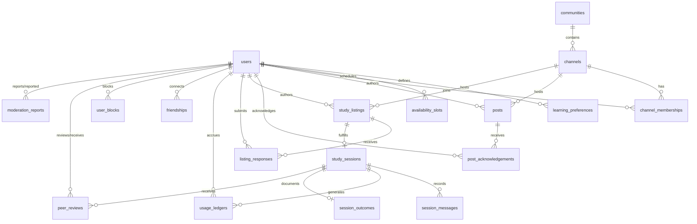

# Relational Data Model Specification

## 1. Domain Modeling Philosophy

The relational database schema is **derived directly from functional and non-functional requirements** (FR-01 through FR-19, NFR-01, NFR-02). Rather than constraining the architecture to an arbitrary entity count, the schema establishes dedicated tables for each bounded domain context (identity, communities, listings, sessions, ledgers, reputation, and moderation).



---

## 2. Comprehensive Entity Catalog

### 2.1 Identity, Preferences & Availability

#### `users`
Represents platform accounts across all roles (FR-01, FR-15).
| Column | Type | Constraints | Description |
| :--- | :--- | :--- | :--- |
| `id` | `UUID` | `PRIMARY KEY DEFAULT gen_random_uuid()` | Unique immutable user identifier. |
| `email` | `VARCHAR(255)` | `UNIQUE NOT NULL` | Verified login email. |
| `password_hash` | `VARCHAR(255)` | `NOT NULL` | Argon2id or bcrypt password hash. |
| `display_name` | `VARCHAR(100)` | `NOT NULL` | Public learner handle. |
| `avatar_url` | `VARCHAR(500)` | `NULL` | Public avatar image link. |
| `bio` | `TEXT` | `NULL` | Learner self-description. |
| `timezone` | `VARCHAR(64)` | `NOT NULL DEFAULT 'UTC'` | User local IANA timezone string. |
| `role` | `VARCHAR(32)` | `NOT NULL DEFAULT 'learner'` | System role: `'learner'`, `'admin'`. |
| `privacy_show_partners`| `BOOLEAN` | `NOT NULL DEFAULT FALSE` | Default-private partner visibility toggle. |
| `account_status` | `VARCHAR(32)` | `NOT NULL DEFAULT 'active'` | State: `'active'`, `'suspended'`, `'banned'`.|
| `created_at` | `TIMESTAMPTZ` | `NOT NULL DEFAULT NOW()` | Account registration instant. |
| `updated_at` | `TIMESTAMPTZ` | `NOT NULL DEFAULT NOW()` | Profile modification instant. |

#### `learning_preferences`
Per-topic structured skill levels and study goals (FR-02).
| Column | Type | Constraints | Description |
| :--- | :--- | :--- | :--- |
| `id` | `UUID` | `PRIMARY KEY DEFAULT gen_random_uuid()` | Unique preference record ID. |
| `user_id` | `UUID` | `NOT NULL REFERENCES users(id) ON DELETE CASCADE` | Associated learner. |
| `topic` | `VARCHAR(64)` | `NOT NULL` | Subject domain (e.g., `'Python'`, `'Mathematics'`). |
| `knowledge_level` | `SMALLINT` | `NOT NULL CHECK (knowledge_level IN (1, 2, 3))` | Self-reported level (1=Beginner, 2=Interm, 3=Adv). |
| `goal_category` | `VARCHAR(64)` | `NOT NULL` | Default goal category enum. |
| `spoken_languages` | `TEXT[]` | `NOT NULL CHECK (cardinality(spoken_languages) > 0)` | Array of ISO language codes (e.g., `{'en', 'ru'}`). |
| `created_at` | `TIMESTAMPTZ` | `NOT NULL DEFAULT NOW()` | Record creation timestamp. |
| `updated_at` | `TIMESTAMPTZ` | `NOT NULL DEFAULT NOW()` | Last update timestamp. |
| *Constraints* | `UNIQUE (user_id, topic)` | — | Decouples topic proficiency independently. |

#### `availability_slots`
Declared recurring weekly availability windows for scheduling overlap checks (FR-02, FR-07).
| Column | Type | Constraints | Description |
| :--- | :--- | :--- | :--- |
| `id` | `UUID` | `PRIMARY KEY DEFAULT gen_random_uuid()` | Unique slot ID. |
| `user_id` | `UUID` | `NOT NULL REFERENCES users(id) ON DELETE CASCADE` | Associated learner. |
| `day_of_week` | `SMALLINT` | `NOT NULL CHECK (day_of_week BETWEEN 0 AND 6)` | 0 = Sunday, 1 = Monday, ..., 6 = Saturday. |
| `start_time_utc` | `TIME` | `NOT NULL` | Slot start time in UTC. |
| `end_time_utc` | `TIME` | `NOT NULL CHECK (end_time_utc > start_time_utc)` | Slot end time in UTC. |

---

### 2.2 Communities, Channels & Posts

#### `communities`
High-level topic categories managed by administrators (FR-03).
| Column | Type | Constraints | Description |
| :--- | :--- | :--- | :--- |
| `id` | `UUID` | `PRIMARY KEY DEFAULT gen_random_uuid()` | Unique community ID. |
| `title` | `VARCHAR(128)` | `NOT NULL UNIQUE` | Community title (e.g., "Computer Science"). |
| `slug` | `VARCHAR(128)` | `NOT NULL UNIQUE` | URL-safe identifier. |
| `description` | `TEXT` | `NULL` | Public description. |
| `created_by_id` | `UUID` | `NOT NULL REFERENCES users(id)` | Creating administrator. |
| `created_at` | `TIMESTAMPTZ` | `NOT NULL DEFAULT NOW()` | Creation instant. |

#### `channels`
Specific topic channels within communities (FR-03).
| Column | Type | Constraints | Description |
| :--- | :--- | :--- | :--- |
| `id` | `UUID` | `PRIMARY KEY DEFAULT gen_random_uuid()` | Unique channel ID. |
| `community_id` | `UUID` | `NOT NULL REFERENCES communities(id) ON DELETE CASCADE` | Parent community. |
| `title` | `VARCHAR(128)` | `NOT NULL` | Channel title (e.g., "Python Basics"). |
| `slug` | `VARCHAR(128)` | `NOT NULL` | URL-safe channel slug. |
| `topic_domain` | `VARCHAR(64)` | `NOT NULL` | Topic key used for preference matching. |
| `description` | `TEXT` | `NULL` | Detailed channel rules/description. |
| `created_by_id` | `UUID` | `NOT NULL REFERENCES users(id)` | Authoring learner/admin. |
| `created_at` | `TIMESTAMPTZ` | `NOT NULL DEFAULT NOW()` | Creation instant. |
| *Constraints* | `UNIQUE (community_id, slug)` | — | Unique channel slug per community. |

#### `channel_memberships`
Enforces the mandatory channel membership gate for discovery and posting (FR-04).
| Column | Type | Constraints | Description |
| :--- | :--- | :--- | :--- |
| `id` | `UUID` | `PRIMARY KEY DEFAULT gen_random_uuid()` | Unique membership ID. |
| `user_id` | `UUID` | `NOT NULL REFERENCES users(id) ON DELETE CASCADE` | Subscribing learner. |
| `channel_id` | `UUID` | `NOT NULL REFERENCES channels(id) ON DELETE CASCADE` | Target channel. |
| `joined_at` | `TIMESTAMPTZ` | `NOT NULL DEFAULT NOW()` | Membership grant timestamp. |
| *Constraints* | `UNIQUE (user_id, channel_id)` | — | Prevents duplicate memberships. |

#### `posts`
Channel discussion posts categorized by pedagogical type (FR-05).
| Column | Type | Constraints | Description |
| :--- | :--- | :--- | :--- |
| `id` | `UUID` | `PRIMARY KEY DEFAULT gen_random_uuid()` | Unique post ID. |
| `channel_id` | `UUID` | `NOT NULL REFERENCES channels(id) ON DELETE CASCADE` | Host channel. |
| `author_id` | `UUID` | `NOT NULL REFERENCES users(id) ON DELETE CASCADE` | Authoring learner. |
| `post_type` | `VARCHAR(32)` | `NOT NULL CHECK (post_type IN ('question', 'explanation', 'material', 'progress'))` | Mandatory post category enum. |
| `body` | `TEXT` | `NOT NULL CHECK (length(body) >= 10)` | Post text content. |
| `external_links` | `TEXT[]` | `NOT NULL DEFAULT '{}'` | Validated external web links. |
| `is_hidden` | `BOOLEAN` | `NOT NULL DEFAULT FALSE` | Administrative moderation flag. |
| `created_at` | `TIMESTAMPTZ` | `NOT NULL DEFAULT NOW()` | Publishing instant. |
| `updated_at` | `TIMESTAMPTZ` | `NOT NULL DEFAULT NOW()` | Modification instant. |
| `deleted_at` | `TIMESTAMPTZ` | `NULL` | Soft deletion timestamp. |

#### `post_acknowledgements`
Helpful acknowledgements awarded to posts (FR-05, FR-19).
| Column | Type | Constraints | Description |
| :--- | :--- | :--- | :--- |
| `id` | `UUID` | `PRIMARY KEY DEFAULT gen_random_uuid()` | Unique acknowledgement ID. |
| `post_id` | `UUID` | `NOT NULL REFERENCES posts(id) ON DELETE CASCADE` | Target post. |
| `user_id` | `UUID` | `NOT NULL REFERENCES users(id) ON DELETE CASCADE` | Acknowledging learner. |
| `created_at` | `TIMESTAMPTZ` | `NOT NULL DEFAULT NOW()` | Grant instant. |
| *Constraints* | `UNIQUE (post_id, user_id)` | — | Max 1 acknowledgement per user per post. |

---

### 2.3 Study Listings, Responses & Sessions

#### `study_listings`
Structured study requests published by channel members (FR-06, FR-07).
| Column | Type | Constraints | Description |
| :--- | :--- | :--- | :--- |
| `id` | `UUID` | `PRIMARY KEY DEFAULT gen_random_uuid()` | Unique listing ID. |
| `channel_id` | `UUID` | `NOT NULL REFERENCES channels(id) ON DELETE CASCADE` | Parent topic channel. |
| `author_id` | `UUID` | `NOT NULL REFERENCES users(id) ON DELETE CASCADE` | Contextual Listing Author. |
| `topic_tags` | `TEXT[]` | `NOT NULL CHECK (cardinality(topic_tags) > 0)` | Structured sub-topic tags. |
| `goal_category` | `VARCHAR(64)` | `NOT NULL CHECK (goal_category IN ('understanding_concept', 'practicing_exercises', 'preparing_assessment', 'completing_project'))` | Normalized goal enum. |
| `goal_details` | `TEXT` | `NULL` | Free-text goal specifics for human inspection. |
| `author_level` | `SMALLINT` | `NOT NULL CHECK (author_level IN (1, 2, 3))` | Author's declared topic knowledge level. |
| `target_level` | `SMALLINT` | `NULL CHECK (target_level IN (1, 2, 3))` | Optional desired peer knowledge level. |
| `language` | `VARCHAR(16)` | `NOT NULL` | Required communication language. |
| `scheduled_start_time`| `TIMESTAMPTZ` | `NOT NULL` | Planned session start in UTC. |
| `duration_minutes` | `SMALLINT` | `NOT NULL CHECK (duration_minutes BETWEEN 15 AND 180)` | Planned session duration. |
| `status` | `VARCHAR(32)` | `NOT NULL DEFAULT 'open' CHECK (status IN ('open', 'matched', 'closed', 'cancelled'))` | Listing lifecycle state. |
| `created_at` | `TIMESTAMPTZ` | `NOT NULL DEFAULT NOW()` | Publication instant. |
| `updated_at` | `TIMESTAMPTZ` | `NOT NULL DEFAULT NOW()` | Last modification instant. |

#### `listing_responses`
Peer applications to join an open study listing (FR-08, FR-09).
| Column | Type | Constraints | Description |
| :--- | :--- | :--- | :--- |
| `id` | `UUID` | `PRIMARY KEY DEFAULT gen_random_uuid()` | Unique response ID. |
| `listing_id` | `UUID` | `NOT NULL REFERENCES study_listings(id) ON DELETE CASCADE` | Target listing. |
| `respondent_id` | `UUID` | `NOT NULL REFERENCES users(id) ON DELETE CASCADE` | Contextual Respondent. |
| `status` | `VARCHAR(32)` | `NOT NULL DEFAULT 'pending' CHECK (status IN ('pending', 'accepted', 'declined', 'withdrawn'))` | Response state. |
| `notes` | `TEXT` | `NULL` | Optional greeting / context message. |
| `created_at` | `TIMESTAMPTZ` | `NOT NULL DEFAULT NOW()` | Submission instant. |
| `updated_at` | `TIMESTAMPTZ` | `NOT NULL DEFAULT NOW()` | Status change instant. |
| *Constraints* | `UNIQUE (listing_id, respondent_id)` | — | Prevents duplicate applications. |

#### `study_sessions`
Represents the locked 1-to-1 study session (FR-09, FR-10, FR-11, FR-17).
| Column | Type | Constraints | Description |
| :--- | :--- | :--- | :--- |
| `id` | `UUID` | `PRIMARY KEY DEFAULT gen_random_uuid()` | Unique session ID. |
| `listing_id` | `UUID` | `NOT NULL UNIQUE REFERENCES study_listings(id)` | 1 listing leads to at most 1 session. |
| `user_a_id` | `UUID` | `NOT NULL REFERENCES users(id)` | Listing author participant. |
| `user_b_id` | `UUID` | `NOT NULL REFERENCES users(id)` | Accepted respondent participant. |
| `status` | `VARCHAR(32)` | `NOT NULL DEFAULT 'scheduled' CHECK (status IN ('scheduled', 'active', 'ended', 'cancelled', 'no_show'))` | Session state machine. |
| `scheduled_start_time`| `TIMESTAMPTZ` | `NOT NULL` | Planned start instant. |
| `duration_minutes` | `SMALLINT` | `NOT NULL` | Planned duration in minutes. |
| `actual_start_time` | `TIMESTAMPTZ` | `NULL` | Mutual join/start instant. |
| `ended_at` | `TIMESTAMPTZ` | `NULL` | Termination instant. |
| `counted_duration_seconds`| `INTEGER` | `NOT NULL DEFAULT 0` | Monotonic server-counted seconds. |
| `end_reason` | `VARCHAR(32)` | `NULL CHECK (end_reason IN ('manual_exit', 'scheduled_end', 'allowance_exhaustion', 'connection_interruption'))` | Termination trigger. |
| `created_at` | `TIMESTAMPTZ` | `NOT NULL DEFAULT NOW()` | Creation instant. |
| `updated_at` | `TIMESTAMPTZ` | `NOT NULL DEFAULT NOW()` | State change instant. |

#### `session_messages`
Synchronous text chat exchanged during active sessions (FR-10).
| Column | Type | Constraints | Description |
| :--- | :--- | :--- | :--- |
| `id` | `UUID` | `PRIMARY KEY DEFAULT gen_random_uuid()` | Unique message ID. |
| `session_id` | `UUID` | `NOT NULL REFERENCES study_sessions(id) ON DELETE CASCADE` | Parent session. |
| `sender_id` | `UUID` | `NOT NULL REFERENCES users(id)` | Message sender. |
| `message_body` | `TEXT` | `NOT NULL CHECK (length(message_body) > 0)` | Chat text. |
| `server_timestamp` | `TIMESTAMPTZ` | `NOT NULL DEFAULT NOW()` | Authoritative server arrival timestamp. |

---

### 2.4 Accounting, Outcomes, Reputation & Moderation

#### `usage_ledgers`
Maintains accounted study time apportioned by user and calendar date (FR-11).
| Column | Type | Constraints | Description |
| :--- | :--- | :--- | :--- |
| `id` | `UUID` | `PRIMARY KEY DEFAULT gen_random_uuid()` | Unique ledger entry ID. |
| `session_id` | `UUID` | `NOT NULL REFERENCES study_sessions(id) ON DELETE CASCADE` | Associated session. |
| `user_id` | `UUID` | `NOT NULL REFERENCES users(id) ON DELETE CASCADE` | Credited learner. |
| `utc_date` | `DATE` | `NOT NULL` | Accounting calendar date (UTC). |
| `counted_minutes` | `SMALLINT` | `NOT NULL CHECK (counted_minutes >= 0)` | Minutes deducted from daily allowance. |
| `created_at` | `TIMESTAMPTZ` | `NOT NULL DEFAULT NOW()` | Immutable audit insertion instant. |
| *Constraints* | `UNIQUE (session_id, user_id, utc_date)` | — | Prevents duplicate time accrual. |

#### `session_outcomes`
Mutually approved topics and study notes (FR-12).
| Column | Type | Constraints | Description |
| :--- | :--- | :--- | :--- |
| `id` | `UUID` | `PRIMARY KEY DEFAULT gen_random_uuid()` | Unique outcome record ID. |
| `session_id` | `UUID` | `NOT NULL UNIQUE REFERENCES study_sessions(id) ON DELETE CASCADE` | 1 outcome per session. |
| `author_id` | `UUID` | `NOT NULL REFERENCES users(id)` | Learner who drafted the notes. |
| `topics_covered` | `TEXT[]` | `NOT NULL` | Array of confirmed sub-topic tags. |
| `outcome_notes` | `TEXT` | `NULL` | Shared study notes / problem solutions. |
| `version` | `INTEGER` | `NOT NULL DEFAULT 1` | Increments on any modification. |
| `is_mutually_confirmed`| `BOOLEAN` | `NOT NULL DEFAULT FALSE` | True only when approved by partner. |
| `partner_confirmed_at` | `TIMESTAMPTZ` | `NULL` | Partner approval instant. |
| `created_at` | `TIMESTAMPTZ` | `NOT NULL DEFAULT NOW()` | Initial submission instant. |
| `updated_at` | `TIMESTAMPTZ` | `NOT NULL DEFAULT NOW()` | Modification instant. |

#### `peer_reviews`
Post-session peer reviews for sessions $\ge 5\text{ accounted minutes}$ (FR-13, FR-19).
| Column | Type | Constraints | Description |
| :--- | :--- | :--- | :--- |
| `id` | `UUID` | `PRIMARY KEY DEFAULT gen_random_uuid()` | Unique review ID. |
| `session_id` | `UUID` | `NOT NULL REFERENCES study_sessions(id) ON DELETE CASCADE` | Associated session. |
| `reviewer_id` | `UUID` | `NOT NULL REFERENCES users(id)` | Author of review. |
| `recipient_id` | `UUID` | `NOT NULL REFERENCES users(id)` | Evaluated peer partner. |
| `rating` | `SMALLINT` | `NOT NULL CHECK (rating BETWEEN 1 AND 5)` | 1 to 5 star evaluation. |
| `review_text` | `TEXT` | `NULL` | Optional qualitative feedback. |
| `created_at` | `TIMESTAMPTZ` | `NOT NULL DEFAULT NOW()` | Review submission instant. |
| *Constraints* | `UNIQUE (session_id, reviewer_id)` | — | At most 1 review per participant per session. |

#### `friendships`
Bidirectional social links modulating presence visibility (FR-18).
| Column | Type | Constraints | Description |
| :--- | :--- | :--- | :--- |
| `id` | `UUID` | `PRIMARY KEY DEFAULT gen_random_uuid()` | Unique friendship record ID. |
| `user_id` | `UUID` | `NOT NULL REFERENCES users(id) ON DELETE CASCADE` | Initiating learner. |
| `friend_id` | `UUID` | `NOT NULL REFERENCES users(id) ON DELETE CASCADE` | Target peer learner. |
| `status` | `VARCHAR(32)` | `NOT NULL DEFAULT 'pending' CHECK (status IN ('pending', 'accepted', 'declined'))` | Link state. |
| `created_at` | `TIMESTAMPTZ` | `NOT NULL DEFAULT NOW()` | Request instant. |
| `updated_at` | `TIMESTAMPTZ` | `NOT NULL DEFAULT NOW()` | State change instant. |
| *Constraints* | `CHECK (user_id != friend_id)` | — | Self-friendship prohibited. |

#### `user_blocks`
Bidirectional safety mechanism suppressing discovery and messaging (FR-16).
| Column | Type | Constraints | Description |
| :--- | :--- | :--- | :--- |
| `id` | `UUID` | `PRIMARY KEY DEFAULT gen_random_uuid()` | Unique block ID. |
| `blocker_id` | `UUID` | `NOT NULL REFERENCES users(id) ON DELETE CASCADE` | Blocking learner. |
| `blocked_id` | `UUID` | `NOT NULL REFERENCES users(id) ON DELETE CASCADE` | Blocked learner. |
| `created_at` | `TIMESTAMPTZ` | `NOT NULL DEFAULT NOW()` | Block placement instant. |
| *Constraints* | `UNIQUE (blocker_id, blocked_id)` | — | Unique block pair. |

#### `moderation_reports`
User reports submitted for administrative moderation (FR-16).
| Column | Type | Constraints | Description |
| :--- | :--- | :--- | :--- |
| `id` | `UUID` | `PRIMARY KEY DEFAULT gen_random_uuid()` | Unique report ID. |
| `reporter_id` | `UUID` | `NOT NULL REFERENCES users(id)` | Reporting user. |
| `reported_id` | `UUID` | `NOT NULL REFERENCES users(id)` | Accused user. |
| `session_id` | `UUID` | `NULL REFERENCES study_sessions(id)` | Optional session context. |
| `post_id` | `UUID` | `NULL REFERENCES posts(id)` | Optional post context. |
| `category` | `VARCHAR(64)` | `NOT NULL` | Category: `'harassment'`, `'spam'`, `'no_show'`. |
| `description` | `TEXT` | `NOT NULL` | Narrative report details. |
| `status` | `VARCHAR(32)` | `NOT NULL DEFAULT 'pending' CHECK (status IN ('pending', 'reviewed', 'dismissed', 'actioned'))` | Moderation queue status. |
| `resolved_by_id` | `UUID` | `NULL REFERENCES users(id)` | Resolving administrator. |
| `resolved_at` | `TIMESTAMPTZ` | `NULL` | Resolution instant. |
| `created_at` | `TIMESTAMPTZ` | `NOT NULL DEFAULT NOW()` | Report submission instant. |

---

## 3. Database Indexing Strategy

To guarantee high throughput and comply with performance requirement **NFR-05** (p95 $< 1000\text{ ms}$ with 1,000 listings):

```sql
-- 1. Accelerate channel-gated listing searches
CREATE INDEX idx_listings_channel_status ON study_listings(channel_id, status) 
WHERE status = 'open';

-- 2. Fast scheduled time overlap checks
CREATE INDEX idx_listings_start_time ON study_listings(scheduled_start_time);

-- 3. GIN index for topic tag array overlap (Jaccard T computation)
CREATE INDEX idx_listings_topic_tags_gin ON study_listings USING GIN (topic_tags);

-- 4. Fast channel membership gating check
CREATE INDEX idx_memberships_user_channel ON channel_memberships(user_id, channel_id);

-- 5. Active session lookup per user (enforces single concurrent active session)
CREATE INDEX idx_sessions_active_participants ON study_sessions(user_a_id, user_b_id) 
WHERE status = 'active';

-- 6. Usage ledger daily sum queries
CREATE INDEX idx_usage_user_utc_date ON usage_ledgers(user_id, utc_date);

-- 7. Moderation block suppression index
CREATE INDEX idx_blocks_lookup ON user_blocks(blocker_id, blocked_id);
```
