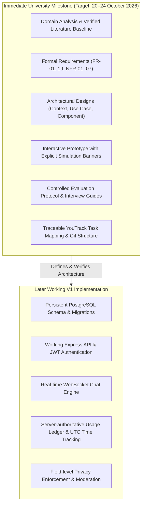

# Project Scope and Delivery Boundaries

## 1. System Vision and Core Purpose
The project develops a web-based peer learning platform aimed at connecting self-directed learners for focused, one-to-one study sessions. Rather than providing automated tutoring or open generic chat forums, this system addresses the coordination problem through **explainable multi-attribute matching** based on structured criteria: topic tags, normalized goals, self-reported knowledge levels, language proficiency, and complete time availability overlap.

---

## 2. Delivery Boundary Separation

To ensure academic rigor, defensibility, and feasible engineering, the project maintains an explicit delivery boundary between the **Immediate University Milestone** and the **Later Working V1**:

### 2.1 Immediate University Milestone
- **Supervisor-Review Target**: **20 October 2026** *(Working target)*
- **Stated Repository Milestone**: **24 October 2026** *(Designation as "Pre-defense 1" requires institutional confirmation; deadline discrepancy remains unresolved)*
- **Completion Boundary**:
  - The end-to-end 12-step learner scenario can be demonstrated interactively.
  - Mocked authentication, session timers, and in-memory persistence are permitted and clearly identified via visible simulation banners.
  - Persistent database integration and deployed cloud backends are explicitly **not required** at this stage.
  - Literature review sources and relevance interview templates are structured and actively populated; pending field data is transparently labeled as pending.

### 2.2 Later Working V1 Deliverable
- **Completion Boundary**:
  - Full relational persistence in PostgreSQL.
  - Working Express API passing automated integration tests.
  - Transactional acceptance of listings with row-level locks and idempotent session finalization.
  - Persistent real-time WebSocket chat and UTC-based time accounting.

---

## 3. Detailed First-Version (V1) Functional Limits

1. **One-to-One Session Bounding**:
   - Each study listing leads to at most one scheduled one-to-one session.
   - Recurring calendar series and automated rescheduling workflows are deferred to future revisions; users cancel and create a new listing if rescheduling is required.
2. **Channel Content and Posting**:
   - Posts are restricted to plain text and external web links.
   - Posts require an explicit category: `question`, `explanation`, `material`, or `progress`.
   - File uploads, binary cloud storage, and nested multi-tier comment threads are deferred to prevent content hosting overhead.
3. **Communication Medium**:
   - In-platform session communication is restricted to real-time text chat with server timestamps.
   - Voice and video streaming are excluded from system architecture and dependencies; sessions are conducted entirely via synchronous in-platform text chat.
4. **Structured Learner Profiles & Matching**:
   - Profiles capture explicit structured fields: topic tags, normalized goal categories, topic-specific knowledge level descriptors, spoken languages, and availability slots.
   - Black-box psychometrics, unsupervised clustering, or inferred personality matchmaking are strictly excluded.
5. **Time Accounting and Allowances**:
   - **Accounted Participation Rule**: Tracked session time reflects **accounted active participation duration** under mutual presence; it does not constitute proof of mental attention, deep study, or subject mastery.
   - **Daily Allowance (Confirmed)**: Free learners are allotted **180 minutes of total study time per day** across all sessions.
   - **UTC Daily Reset (Proposed)**: Daily reset boundary occurs at $00:00\text{--}24:00\text{ UTC}$ to ensure deterministic, cheat-resistant accounting across disparate time zones.
   - **Early-Start Guard & Late-Start Rule (Proposed)**: Sessions cannot start before `scheduled_start`. Scheduled end is fixed at `scheduled_start + duration`; late starts do not extend the scheduled end.
6. **Reputation & Review Bounds**:
   - Reputation is strictly computed from auditable historical facts: eligible completed session count, accounted study time, average rating with review count, and mutually confirmed topics.
   - One combined opaque "mastery" or "karma" score is avoided.
   - **5-Minute Review Threshold (Proposed)**: Sessions must reach at least $300\text{ accounted seconds}$ ($5\text{ minutes}$) to qualify for public completion badges or review submission; shorter sessions remain visible only in private history.
   - **Session Outcomes & Mutual Confirmation**: Recording session outcomes is Confirmed. Requiring both participants to confirm the same outcome version is Proposed. If implemented, mutual confirmation follows FR-12’s version-safe protocol and contributes to reputation only under the separately proposed eligibility rules.
7. **Social & Friendship Mechanics**:
   - Friendship interactions are limited to `request`, `accept`, `decline`, and `remove`.
   - Friendship modulates social presence visibility but does not grant access to another user's private session history.
8. **Deployment Architecture**:
   - Single deployable modular monolith backed by a single relational database (PostgreSQL); no microservices, distributed queues, or complex orchestrators.

---

## 4. Confirmed Exclusions and Defense Rationale

### 4.1 Excluded Features
- Verified paid teachers, professional tutors, and fee-for-service models.
- Subscription tiers, premium channels, creator tipping, and monetary transactions.
- Cloud document storage and binary file management.
- Native WebRTC audio/video call handling.
- Automated psychometric/personality profiling.

### 4.2 Academic and Defense Rationale
Boud et al. (2001) and Topping (2005) emphasize that peer learning mechanisms derive efficacy from mutual reciprocity, clear objective-setting, and cognitive compatibility. Integrating commercial transactions, complex tutoring hierarchies, or video infrastructure introduces immense infrastructure complexity without contributing to the central research question: **How does structured, explainable compatibility matching affect peer discovery and collaboration?**

---

## 5. Existing Systems Comparison Framework

To satisfy the university requirements for **Existing System Comparison** (evaluating 3–5 systems across 6–10 criteria), the comparative matrix will evaluate candidate platforms (Focusmate, Tandem, Brainly, Discord Study servers, and Studypool) across the following **10 uniform criteria**:

| № | Uniform Criterion | Dimension Evaluated | Relevance to Peer Learning |
| :-: | :--- | :--- | :--- |
| **C1** | **Community Structure** | Are study topics organized into structured channels/communities? | Eliminates noise and scopes discovery. |
| **C2** | **Structured Study Listings** | Can users define explicit learning objectives, topics, and duration? | Standardizes scheduling and study expectations. |
| **C3** | **Multi-Attribute Matching** | Does the platform match users using composite compatibility criteria? | Solves the core coordination problem. |
| **C4** | **Explainability of Matches** | Are recommendation reasons visible and understandable to learners? | Fosters user trust and agency in selection. |
| **C5** | **Knowledge Level Handling** | Does the platform support topic-specific knowledge level descriptors? | Prevents mismatch in skill expectations. |
| **C6** | **Timezone & Availability Gating** | Are potential partners filtered by complete schedule overlap? | Eliminates manual scheduling back-and-forth. |
| **C7** | **Accounted Synchronous Time** | Does the system track and bound active study session duration? | Provides accountability and prevents indefinite calls. |
| **C8** | **Mutual Outcome Confirmation** | Can participants jointly document and confirm covered topics? | Verifies session completion and learning goals. |
| **C9** | **Default Privacy & Safety** | Are study histories and past partner lists private by default? | Protects user privacy and prevents unwanted tracking. |
| **C10**| **Non-Commercial Reciprocity** | Is the platform free from paid tutoring hierarchies and fees? | Preserves equal peer reciprocity. |

---

## 6. Specification Design Choices vs. Institutional Requirements

| Aspect | Classification | Nature / Rationale |
| :--- | :--- | :--- |
| **Submission Deadline (24 Oct)** | Institutional Milestone | Stated university milestone; designation as "Pre-defense 1" pending formal confirmation. |
| **Supervisor Review (20 Oct)** | Working Operational Target | Target package date agreed upon to incorporate supervisor feedback prior to the 24 Oct milestone. |
| **FR-01..19 / NFR-01..07 Numbering** | Specification Choice | Internal taxonomic numbering chosen for traceability across requirements, tests, and YouTrack tasks. |
| **Relational Database Entities** | Specification Choice | Derived directly from requirements; not constrained to an arbitrary count. |
| **180-Minute Daily Study Allowance** | Confirmed Requirement | Confirmed maximum daily study time per free learner across sessions. |
| **Previous Partners Private by Default**| Confirmed Requirement | Confirmed privacy boundary; exposed only via explicit user opt-in. |
| **Session Outcomes & Mutual Confirmation** | Recording Confirmed; Mutual Confirmation Proposed | Recording session outcomes is Confirmed. Requiring both participants to confirm the same outcome version is Proposed. If implemented, mutual confirmation follows FR-12’s version-safe protocol. |
| **Matching Weights (0.40T, 0.35G, 0.25L)**| Proposed Design Rule | Working transparent starting hypothesis; subject to empirical validation during user research. |
| **UTC Daily Reset (00:00 UTC)** | Proposed Design Rule | Engineered to eliminate timezone-manipulation abuse; user-local reset remains a candidate. |
| **60-Second Grace Period** | Proposed Design Rule | Reconnection buffer for temporary socket drops during active sessions. |
| **5-Minute Review Threshold** | Proposed Design Rule | Anti-abuse filter to prevent spamming reviews on trivial or zero-duration sessions. |
| **10–20 Participant Evaluation** | Proposed Research Plan | Defensible sample size for qualitative and counterbalanced usability testing, not an institutional minimum. |
