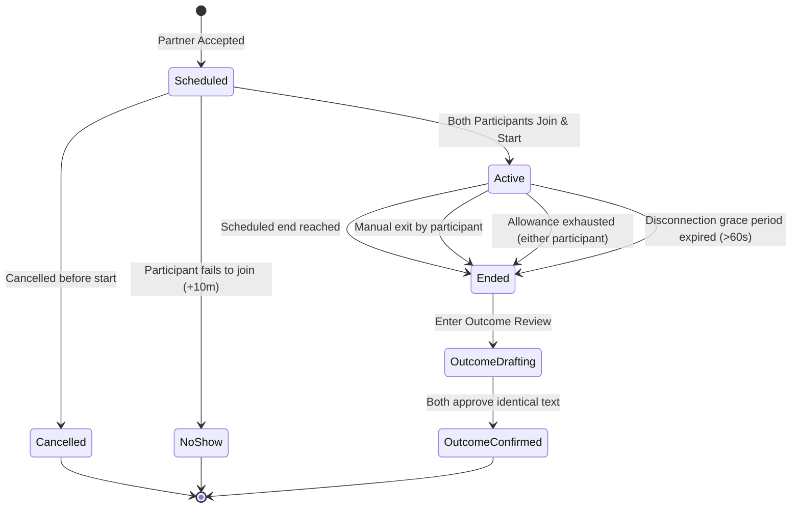

# One-to-One Session Lifecycle & Time Accounting Specification

## 1. Session State Machine

The session engine governs one-to-one study interactions, coordinating real-time messaging, server-authoritative timekeeping, daily allowance decrements, and outcome finalization.



### 1.1 Formal State Definitions
- **`scheduled`**: The listing author accepted a respondent. The session interval is reserved. Chat and time tracking are inactive.
- **`active`**: Both participants have explicitly connected and clicked "Start". Real-time chat is unlocked and server wall-clock timer is running.
- **`ended`**: Active session has terminated via an authorized trigger. Chat is locked (read-only). Counted duration is finalized into the usage ledger.
- **`cancelled`** *(Terminal Alternative)*: Either participant aborted the session prior to mutual start. No study time is credited.
- **`no_show`** *(Terminal Alternative)*: One participant joined at the scheduled time, but the partner failed to arrive within the 10-minute arrival window. No study time is credited.

---

## 2. Session Accounting & Running Invariants

### 2.1 Server-Authoritative Timekeeping
- **Client Passive Mirroring**: Browser and client timers only display server state received via WebSocket heartbeats or REST synchronization. The client never transmits duration values to the server.
- **Monotonic Wall-Clock Tracking**: The server measures active elapsed duration using monotonic server timestamps:
  $$\Delta t_{\text{session}} = t_{\text{end}} - t_{\text{start}} - t_{\text{pause}}$$
- **Single Concurrent Session Limit**: A learner is permitted at most **one** active session at any instant. Attempting to start or join a concurrent active session returns HTTP 409 Conflict.
- **Tab & Refresh Deduplication**: Refreshing a browser, switching devices, or opening multiple browser tabs references the same server session ID and does not duplicate or accelerate counted time.

### 2.2 Maximum Running Duration Bounds
The maximum duration of an active session is bounded dynamically by:
$$T_{\text{max\_allowed}} = \min\left(T_{\text{scheduled\_duration}}, \text{Allowance}_{\text{userA}}, \text{Allowance}_{\text{userB}}\right)$$
Where:
- $T_{\text{scheduled\_duration}}$ is the agreed duration (e.g., 30, 45, 60 minutes).
- $\text{Allowance}_{\text{user}}$ is the remaining daily study allowance for that user.

---

## 3. Daily Allowance & Day Boundary Rules

### 3.1 180-Minute Daily Study Allowance (Proposed Design Rule)
- Each free learner account is allocated $180\text{ minutes}$ of total accounted study time per calendar day.
- Allowance is shared across all study sessions attended on that calendar date.
- Once a learner's remaining allowance reaches $0$, active sessions immediately transition to `ended` with reason `allowance_exhaustion`, and new messages are rejected.

### 3.2 Day Boundary & Cross-Midnight Splitting (Proposed Design Rule)
- **Accounting Boundary**: The daily accounting boundary is fixed at **00:00–24:00 UTC** for all users, regardless of local time zones.
- **Local Display**: The client UI displays the reset time translated to the user's local timezone (e.g., *00:00 UTC resets at 05:00 local time in UTC+5*).
- **Cross-Midnight Apportionment**:
  If an active session spans across the `00:00:00 UTC` boundary, the server atomically apportions counted minutes across two distinct ledger records:
  - *Example*: A 45-minute session running from `23:45 UTC` to `00:30 UTC`:
    - Day 1 (before 24:00 UTC): 15 minutes decremented from Day 1 allowance.
    - Day 2 (after 00:00 UTC): 30 minutes decremented from the freshly replenished Day 2 allowance.
- **Defense Rationale**: Enforcing a strict UTC boundary eliminates timezone-switching exploits where a user could repeatedly alter their local system clock to claim extra study allowances.

---

## 4. Presence, Disconnection & Reconnection Rules

### 4.1 60-Second Disconnection Grace Period (Proposed Design Rule)
Network drops and accidental page refreshes are handled via a server-enforced presence grace timer:
1. When a participant's WebSocket connection drops, the server marks their presence as `temporarily_disconnected` and starts a 60-second grace timer.
2. The remaining participant sees an inline alert: *"Partner disconnected. Waiting up to 60s for reconnection..."*
3. **Case A (Reconnection within 60s)**: If the disconnected partner reconnects before the timer expires, presence status restores to `connected`. The grace period interval is charged consistently to both learners to maintain synchronized wall-clock alignment.
4. **Case B (Grace Period Expiry)**: If the partner does not reconnect within 60 seconds, the server terminates the session with terminal reason:
   $$\text{end\_reason} = \texttt{connection\_interruption}$$
   The session is finalized, credited time up to the disconnection point (plus 60s grace) is logged, and both participants are released.

---

## 5. Terminal Triggers & Idempotent Finalization

### 5.1 Terminal Reasons
When a session transitions to `ended`, one immutable `end_reason` is stored:
1. `manual_exit`: One participant clicked "End Session Early".
2. `scheduled_end`: The agreed session duration was reached.
3. `allowance_exhaustion`: Either participant's remaining daily allowance reached 0 minutes.
4. `connection_interruption`: A participant remained disconnected beyond the 60-second grace window.

### 5.2 Idempotent Database Finalization
Session finalization is wrapped in a database transaction with row-level locking:
```sql
BEGIN;
  -- Lock session record to prevent concurrent duplicate finalization
  SELECT * FROM sessions WHERE id = :session_id FOR UPDATE;

  -- Verify session is not already ended
  IF sessions.status != 'ended' THEN
    UPDATE sessions 
    SET status = 'ended', 
        ended_at = :now, 
        end_reason = :reason,
        counted_duration_seconds = :duration
    WHERE id = :session_id;

    -- Insert immutable usage ledger entry
    INSERT INTO usage_ledgers (session_id, user_id, utc_date, counted_minutes)
    VALUES 
      (:session_id, :user_a_id, :utc_date, :minutes),
      (:session_id, :user_b_id, :utc_date, :minutes);
  END IF;
COMMIT;
```
- **Idempotency Guarantee**: If multiple network retries or client tabs issue `POST /sessions/:id/end`, the first request commits the final ledger; subsequent requests detect `status == 'ended'` and return the existing record without double-charging minutes.

---

## 6. Review & Reputation Qualification Threshold

### 6.1 5-Minute Minimum Qualification Rule (Proposed Design Rule)
To prevent review bombing, spamming, or fraudulent reputation inflation through micro-sessions:
- **Duration $\ge 300\text{ seconds}$ ($\ge 5\text{ accounted minutes}$)**:
  - Session is eligible for partner review submission (FR-13).
  - Increments each learner's "Completed Sessions" public reputation counter.
  - Mutually approved outcomes appear on public profile badges.
- **Duration $< 300\text{ seconds}$ ($< 5\text{ accounted minutes}$)**:
  - Session is recorded exclusively in the learner's **private history** (FR-14).
  - Explicitly ineligible for review submission or public completion badges.
  - Counted minutes are still deducted from the daily allowance to prevent allowance abuse.
