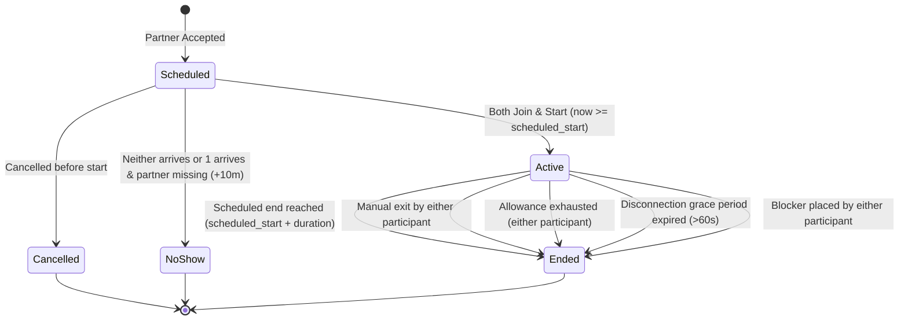

# One-to-One Session Lifecycle & Time Accounting Specification

## 1. Session State Machine

The session engine coordinates synchronous one-to-one study interactions, server-authoritative timekeeping, daily study allowance decrements, and terminal transitions.

> **Critical State Boundary**: The session lifecycle reaches a strict terminal state at **`ended`** (or `cancelled`, `no_show`). **Outcome drafting and peer reviews are post-session actions tracked in separate entity tables (`session_outcomes`, `peer_reviews`) and do not alter the terminal session state.**

### 1.1 Formal State Definitions
- **`scheduled`**: The listing author has accepted a respondent. The session slot is reserved. Real-time chat is disabled and timers are inactive.
- **`active`**: Both participants have connected and explicitly confirmed start after `scheduled_start`. Chat is active and monotonic server time tracking is running.
- **`ended`**: Terminal state. Active session ended via an authorized trigger (`scheduled_end`, `manual_exit`, `allowance_exhaustion`, `connection_interruption`, `blocked`). Chat is locked to read-only history for participants. Counted duration is finalized into immutable `usage_ledgers`.
- **`cancelled`** *(Terminal Alternative)*: Either participant cancelled before start, or an active block was placed before start. 0 study seconds credited.
- **`no_show`** *(Terminal Alternative)*: Neither participant joined, or one participant arrived but the other failed to join within 10 minutes of `scheduled_start`. 0 study seconds credited.

---

## 2. Server-Authoritative Timekeeping & Running Invariants

### 2.1 Start-Time Guard & Late-Start Rules
1. **Early-Start Guard**: A session **cannot be started early**. The "Start Session" action is unlocked only when:
   $$\text{server\_time\_utc} \ge \text{scheduled\_start}$$
2. **Fixed Scheduled End**: The session's scheduled end boundary is immutably anchored to:
   $$\text{scheduled\_end} = \text{scheduled\_start} + \text{duration}$$
3. **Late-Start Invariant**: **A late start does NOT extend the scheduled end time.**
   - If a session is booked for 14:00–15:00 (duration: 60 min) and both participants start at 14:08, the session **still terminates at 15:00**.
   - Counted active duration is bounded by actual elapsed wall-clock time:
     $$\Delta t_{\text{elapsed}} = \min(t_{\text{ended}}, \text{scheduled\_end}) - t_{\text{actual\_start}} = 15:00 - 14:08 = 52\text{ minutes}$$
4. **No Pause State**: The platform does not support pausing. Time runs continuously during active mutual presence until termination.

### 2.2 Client-Server Synchronization
- **Passive Client Timers**: Client interfaces display time remaining based strictly on server synchronization payloads. Clients never calculate or transmit session duration to the server.
- **Single Concurrent Session Limit**: A learner is prohibited from participating in more than one `active` session simultaneously. Attempting to enter another session while active returns HTTP 409 Conflict.
- **Tab & Refresh Deduplication**: Multiple tabs or browser refreshes reference the single active server session instance and do not duplicate accrued minutes.

---

## 3. Daily allowance and accounting boundaries

**Confirmed:** each free learner has **180 total study minutes per day**, shared across sessions.

**Proposed implementation rules:** UTC accounting days, integer-second accounting, and the exact-midnight precedence policy below.

### 3.1 Units and intervals

- The daily allowance is represented as **10,800 integer seconds**.
- Authoritative accounting timestamps use whole-second resolution.
- A session’s charged interval is `[actual_start_time, effective_end_time)`.
- No rounding upward is applied to sessions or daily segments.
- Minutes are a display conversion only; the authoritative ledger stores seconds.
- Both participants receive identical session-duration charges.

A late start does not extend `scheduled_end = scheduled_start_time + duration_minutes × 60 seconds`.

### 3.2 Chosen exact-midnight policy: exhaustion first

**Proposed:** if either learner exhausts their old-day allowance exactly at midnight, the session ends at midnight. The new day’s allowance does not revive or automatically restart that session.

If both learners still have positive old-day allowance immediately before crossing midnight after charging the preceding interval, the session may continue into the new accounting day.

A session whose scheduled end is midnight ends at midnight regardless of the allowance reset.

This policy preserves the rule that exhausting the applicable allowance ends the session.

### 3.3 Day-boundary splitting

For each UTC date touched by the charged interval, compute the intersection:

`[actual_start_time, effective_end_time) ∩ [day_start, next_day_start)`

The intersection’s length in integer seconds is that date’s charge for each participant. Do not create zero-second ledger rows.

For V1, ledger rows are written only during finalization. While a session is active, remaining allowance is calculated from:

1. Finalized ledger usage for that learner and UTC date; plus
2. The active session’s elapsed charge attributable to that date.

This avoids both duplicate midnight writes and omission of active usage. Before starting another session, any prior active session must be reconciled and finalized where due.

### 3.4 Effective termination time

The effective end is the earliest applicable instant among:

- Fixed scheduled end.
- Either participant’s allowance-exhaustion instant.
- An authorized manual-end event.
- An authorized blocking event.
- Disconnection-grace expiry.
- A recovery cutoff established under the documented restart rule.

Manual-end and blocking events take effect at the server’s authorized state transition while holding the required locks. Clients cannot supply effective timestamps.

Allowance exhaustion is calculated chronologically through each UTC-day segment. Reaching zero at a day boundary ends the session before replenishment is considered.

For equal termination instants, use this deterministic reason priority:

1. `blocked`
2. `allowance_exhaustion`
3. `scheduled_end`
4. `connection_interruption`
5. `manual_exit`

This priority selects a reason only; it does not change the charged interval.

A delayed timer or finalization worker does not extend the session. Message handling must reject a message at or after the effective end, even if the stored status has not yet been reconciled.

---

## 4. Presence, Disconnection & Failure Scenarios

### 4.1 60-Second Disconnection Grace Period (Proposed Design Rule)
1. **Single Socket Disconnection**: If one participant drops connection while the other remains connected, the server transitions presence to `temporarily_disconnected` and starts a 60-second grace timer.
2. **Reconnection within 60s**: If the participant reconnects within 60 seconds, presence restores to `connected`. The grace interval is counted consistently to both learners to preserve synchronized wall-clock alignment.
3. **Disconnection Expiry**: If reconnection does not occur within 60 seconds, the server terminates the session with terminal reason:
   $$\text{end\_reason} = \texttt{connection\_interruption}$$
   The session transitions to `ended`. Accrued time up to the disconnection point plus the 60s grace interval is ledgered.

### 4.2 Additional Failure & Edge Scenarios
- **Neither Participant Arrives**: If 10 minutes elapse past `scheduled_start` and neither user clicks Start, the server marks the session `no_show`. Counted time = 0 seconds.
- **One Participant Arrives, Partner Missing**: If User A clicks Start but User B fails to arrive within 10 minutes of `scheduled_start`, User A may click "Claim No-Show" (or server auto-expires). Session transitions to `no_show`. Counted time = 0 seconds.
- **Active Session Blocking**: Blocking stops future contact, not access to a participant’s existing records. Both participants retain read-only access to their shared session archive after blocking. Other learners and friends have no access. Administrators may access relevant chat evidence only through an active moderation report filed by a participant. Blocking disables new shared-outcome edits and confirmations between the pair. Existing outcomes remain readable. Reporting remains available. Eligible post-session reviews remain governed by FR-13 and do not reopen chat. A scheduled shared session becomes `cancelled`, with no charge. An active shared session ends using reason `blocked`, subject to any earlier effective termination boundary. Its accrued usage is finalized once.
- **Server Restart Recovery**: The server persists active session start timestamps and regular heartbeat markers. Upon service recovery, any orphaned `active` sessions are finalized based on the last recorded heartbeat, preventing unbounded timer drift.

---

## 5. Terminal Triggers & Idempotent Finalization

**Classification: Proposed implementation design.**

### 5.1 Terminal Reasons
When a session enters `ended`, one immutable `end_reason` is recorded from the exact set of five:
1. `blocked`: Authorized blocking committed during active session.
2. `allowance_exhaustion`: Allowance reduced to 0 integer seconds.
3. `scheduled_end`: Fixed scheduled end reached.
4. `connection_interruption`: Disconnected partner failed to reconnect within 60-second grace.
5. `manual_exit`: Participant voluntarily clicked "End Session Early".

### 5.2 Idempotent Database Finalization

Finalization follows architecture §4.1’s lock protocol: lock both participant user rows in ascending order, then the session row.

1. If status is `ended`, return the existing final result and ledger entries without modification.
2. If status is `scheduled`, `cancelled`, or `no_show`, reject active-session finalization with a state conflict.
3. If status is `active`:
   - Determine the effective end from server-owned state and the rules in §3.
   - Calculate the total integer-second duration.
   - Split the interval into UTC-day charges.
   - Change status to `ended`, recording the effective end, duration, and reason.
   - Insert one positive ledger row per participant per charged UTC date.
4. Commit the session change and all ledger rows atomically.

Enforce `UNIQUE(session_id, user_id, utc_date)`.

Do not use `ON CONFLICT DO NOTHING` to hide a conflicting ledger value. An unexpected existing ledger row for an active session is an integrity error and causes rollback. A normal retry encounters an already-ended session and returns its existing result.

There is no valid partial commit containing ledger charges without the corresponding ended session, or an ended session without all required charges.

---

## 6. Review & Reputation Qualification Threshold

### 6.1 5-Minute Minimum Qualification Rule (Proposed Design Rule)
To prevent reputation manipulation or review spam via zero-duration sessions:
- **Duration $\ge 300\text{ seconds}$ ($\ge 5\text{ accounted minutes}$)**:
  - Participants unlock the right to submit a post-session partner review.
  - The session increments the public "Completed Study Sessions" counter on learner profiles.
  - Shared outcomes become eligible for public profile badges upon mutual confirmation.
- **Duration $< 300\text{ seconds}$ ($< 5\text{ accounted minutes}$)**:
  - The session is recorded **exclusively in the participant's private study history**.
  - Ineligible for partner reviews and public reputation indicators.
  - Accrued seconds are still deducted from the daily allowance to prevent free-time exploitation.

---

## 7. Concrete Accounting Test Fixtures

*(These are formal specification fixtures against which implementations must be verified. All remaining-allowance values refer to both learners unless stated otherwise).*

| ID | Input | Expected outcome |
| --- | --- | --- |
| **A-01: Exact-midnight exhaustion** | Booked 23:45–00:30. A has exactly 900 seconds remaining on Day 1; B has 3,600. Start 23:45. | End at 00:00 with `allowance_exhaustion`. Charge 900 seconds to each participant on Day 1. No Day 2 rows. Session does not restart after reset. |
| **A-02: Sufficient allowance across midnight** | Same booking; both have 3,600 seconds remaining on Day 1. | End 00:30. Each participant receives Day 1 charge 900 and Day 2 charge 1,800. Total 2,700 seconds. |
| **A-03: Scheduled end at midnight** | Booked 23:45–00:00; both have 3,600 seconds remaining. | End 00:00 with `scheduled_end`; charge 900 seconds on Day 1 only. |
| **A-04: End/exhaustion tie** | Same booking as A-03; A has exactly 900 seconds remaining. | End 00:00 with `allowance_exhaustion` under the tie rule. Same 900-second charges; no Day 2 rows. |
| **A-05: Delayed finalization** | Start 14:00; booked end 15:00. A has 600 seconds remaining. Worker runs at 14:12:07. | Effective end 14:10, reason `allowance_exhaustion`; charge 600 seconds each, not 727. Messages at or after 14:10 are rejected. |
| **A-06: Seconds without rounding** | Start 14:00:00; authorized manual end 14:00:31. | Charge exactly 31 seconds each. No rounding to 60 seconds. |
| **A-07: Retry** | Finalize A-02 twice, including concurrent requests. | Four ledger rows total: two participants × two positive-day segments. Repeated calls return the same final state and charges. |
| **S-01: Non-rounded short session** | The 31-second session in A-06. | Produces two 31-second ledger rows, a session duration of 31, and no review eligibility ($31 < 300$). Its daily charge is not rounded to one minute. |
