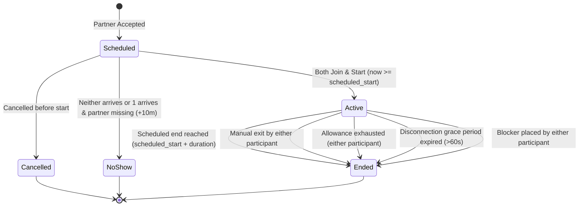

# One-to-One Session Lifecycle & Time Accounting Specification

## 1. Session State Machine

The session engine coordinates synchronous one-to-one study interactions, server-authoritative timekeeping, daily study allowance decrements, and terminal transitions.



> **Critical State Boundary**: The session lifecycle reaches a strict terminal state at **`ended`** (or `cancelled`, `no_show`). **Outcome drafting and peer reviews are post-session actions tracked in separate entity tables (`session_outcomes`, `peer_reviews`) and do not alter the terminal session state.**

### 1.1 Formal State Definitions
- **`scheduled`**: The listing author has accepted a respondent. The session slot is reserved. Real-time chat is disabled and timers are inactive.
- **`active`**: Both participants have connected and explicitly confirmed start after `scheduled_start`. Chat is active and monotonic server time tracking is running.
- **`ended`**: Terminal state. Active session ended via an authorized trigger. Chat is locked to read-only history. Counted duration is finalized into immutable `usage_ledgers`.
- **`cancelled`** *(Terminal Alternative)*: Either participant cancelled before start, or an active block was placed before start. 0 study minutes credited.
- **`no_show`** *(Terminal Alternative)*: Neither participant joined, or one participant arrived but the other failed to join within 10 minutes of `scheduled_start`. 0 study minutes credited.

---

## 2. Server-Authoritative Timekeeping & Running Invariants

### 2.1 Start-Time Guard & Late-Start Rules
1. **Early-Start Guard**: A session **cannot be started early**. The "Start Session" action is unlocked only when:
   $$\text{server\_time\_utc} \ge \text{scheduled\_start}$$
2. **Fixed Scheduled End**: The session's scheduled end boundary is immutably anchored to:
   $$\text{scheduled\_end} = \text{scheduled\_start} + \text{duration}$$
3. **Late-Start Invariant**: **A late start does NOT extend the scheduled end time.**
   - If a session is booked for 14:00–15:00 (duration: 60 min) and both participants start at 14:08, the session **still terminates at 15:00**.
   - Counted active duration is bounded by actual elapsed wall-clock time:
     $$\Delta t_{\text{elapsed}} = \min(t_{\text{ended}}, \text{scheduled\_end}) - t_{\text{actual\_start}} = 15:00 - 14:08 = 52\text{ minutes}$$
4. **No Pause State**: The platform does not support pausing. Time runs continuously during active mutual presence until termination.

### 2.2 Client-Server Synchronization
- **Passive Client Timers**: Client interfaces display time remaining based strictly on server synchronization payloads. Clients never calculate or transmit session duration to the server.
- **Single Concurrent Session Limit**: A learner is prohibited from participating in more than one `active` session simultaneously. Attempting to enter another session while active returns HTTP 409 Conflict.
- **Tab & Refresh Deduplication**: Multiple tabs or browser refreshes reference the single active server session instance and do not duplicate accrued minutes.

---

## 3. Daily Allowance & Midnight Accounting Rules

### 3.1 180-Minute Daily Study Allowance (Confirmed)
- Each free learner account is allocated **180 total study minutes per calendar day** across all sessions (Confirmed requirement).
- When either participant's remaining daily allowance reaches 0, the active session terminates immediately with reason `allowance_exhaustion`, locking chat and ledgering accrued time.

### 3.2 UTC Reset & Cross-Midnight Apportionment (Proposed Design Rule)
- **Accounting Boundary**: The daily boundary is defined as **00:00:00 to 24:00:00 UTC** (Proposed).
- **Cross-Midnight Apportionment**: When an active session spans across the `00:00:00 UTC` boundary, active minutes are apportioned into distinct accounting days:
  - Minutes elapsed before 24:00 UTC are charged to Day 1.
  - Minutes elapsed after 00:00 UTC are charged to Day 2 from the refreshed 180-minute allowance.
- **Exhaustion & Reset Precedence**:
  1. *Exhaustion before midnight*: If a participant has only 10 minutes of remaining allowance on Day 1 and a session begins at 23:45 UTC, the allowance exhausts at **23:55 UTC**. The session terminates at 23:55 UTC with reason `allowance_exhaustion`. It does not reach midnight.
  2. *Survival past midnight*: If both participants have $\ge 15$ minutes of allowance remaining on Day 1, the session runs to 00:00:00 UTC. At midnight, Day 1 is ledgered for 15 minutes, Day 2 allowance refreshes to 180 minutes, and the session continues until scheduled end, subject to Day 2 allowance.

---

## 4. Presence, Disconnection & Failure Scenarios

### 4.1 60-Second Disconnection Grace Period (Proposed Design Rule)
1. **Single Socket Disconnection**: If one participant drops connection while the other remains connected, the server transitions presence to `temporarily_disconnected` and starts a 60-second grace timer.
2. **Reconnection within 60s**: If the participant reconnects within 60 seconds, presence restores to `connected`. The grace interval is counted consistently to both learners to preserve synchronized wall-clock alignment.
3. **Disconnection Expiry**: If reconnection does not occur within 60 seconds, the server terminates the session with terminal reason:
   $$\text{end\_reason} = \texttt{connection\_interruption}$$
   The session transitions to `ended`. Accrued time up to the disconnection point plus the 60s grace interval is ledgered.

### 4.2 Additional Failure & Edge Scenarios
- **Neither Participant Arrives**: If 10 minutes elapse past `scheduled_start` and neither user clicks Start, the server marks the session `no_show`. Counted time = 0 min.
- **One Participant Arrives, Partner Missing**: If User A clicks Start but User B fails to arrive within 10 minutes of `scheduled_start`, User A may click "Claim No-Show" (or server auto-expires). Session transitions to `no_show`. Counted time = 0 min.
- **Active Session Blocking**: If either participant blocks the other during an active session, the session terminates immediately with reason `manual_exit` (or `blocked`). Chat is terminated, accrued time up to that point is finalized once, and no new contact is permitted.
- **Server Restart Recovery**: The server persists active session start timestamps and regular heartbeat markers. Upon service recovery, any orphaned `active` sessions are finalized based on the last recorded heartbeat, preventing unbounded timer drift.

---

## 5. Terminal Triggers & Idempotent Finalization

### 5.1 Terminal Reasons
When a session enters `ended`, one immutable `end_reason` is recorded:
- `scheduled_end`: Normal completion at `scheduled_start + duration`.
- `manual_exit`: Participant voluntarily clicked "End Session Early".
- `allowance_exhaustion`: Either participant reached 0 remaining allowance minutes.
- `connection_interruption`: Disconnected partner did not return within 60s.

### 5.2 Idempotent Database Finalization (Specification Logic)
Finalization executes atomically and must guard against double-finalizing or modifying non-active sessions:

```sql
-- Specification Logic (Pseudocode for Transactional Finalization)
BEGIN TRANSACTION;

  -- 1. Lock the session row exclusively
  SELECT id, status, actual_start_time, scheduled_start_time, duration_minutes
  FROM study_sessions 
  WHERE id = :session_id 
  FOR UPDATE;

  -- 2. Validate current state: ONLY 'active' sessions can be finalized
  IF study_sessions.status = 'ended' THEN
    -- Already finalized: Return existing record idempotently without error
    COMMIT;
    RETURN;
  ELSIF study_sessions.status != 'active' THEN
    -- Scheduled, Cancelled, or No-Show cannot be finalized as completed
    ROLLBACK;
    RAISE EXCEPTION 'Cannot finalize session in state: %', study_sessions.status;
  END IF;

  -- 3. Calculate counted duration bounded by scheduled end
  v_scheduled_end := study_sessions.scheduled_start_time + (study_sessions.duration_minutes * INTERVAL '1 minute');
  v_effective_end := LEAST(:current_time, v_scheduled_end);
  v_counted_seconds := GREATEST(0, EXTRACT(EPOCH FROM (v_effective_end - study_sessions.actual_start_time)));

  -- 4. Transition session status to terminal 'ended'
  UPDATE study_sessions
  SET status = 'ended',
      ended_at = v_effective_end,
      counted_duration_seconds = v_counted_seconds,
      end_reason = :end_reason,
      updated_at = NOW()
  WHERE id = :session_id;

  -- 5. Record usage ledger entry with uniqueness per (session_id, user_id, utc_date)
  INSERT INTO usage_ledgers (session_id, user_id, utc_date, counted_minutes)
  VALUES 
    (:session_id, :user_a_id, :utc_date, CEIL(v_counted_seconds / 60.0)),
    (:session_id, :user_b_id, :utc_date, CEIL(v_counted_seconds / 60.0))
  ON CONFLICT (session_id, user_id, utc_date) DO NOTHING;

COMMIT;
```

---

## 6. Review & Reputation Qualification Threshold

### 6.1 5-Minute Minimum Qualification Rule (Proposed Design Rule)
To prevent reputation manipulation or review spam via zero-duration sessions:
- **Duration $\ge 300\text{ seconds}$ ($\ge 5\text{ accounted minutes}$)**:
  - Participants unlock the right to submit a post-session partner review.
  - The session increments the public "Completed Study Sessions" counter on learner profiles.
  - Shared outcomes become eligible for public profile badges upon mutual confirmation.
- **Duration $< 300\text{ seconds}$ ($< 5\text{ accounted minutes}$)**:
  - The session is recorded **exclusively in the participant's private study history**.
  - Ineligible for partner reviews and public reputation indicators.
  - Accrued minutes are still deducted from the daily allowance to prevent free-time exploitation.

---

## 7. Concrete Accounting Test Fixtures

*(These are formal specification fixtures against which implementations must be verified).*

### Fixture S1: Late Start Duration Cap
- **Booked Session**: 14:00 to 15:00 UTC (duration: 60 minutes).
- **Actual Start**: Both participants connect and click Start at 14:08 UTC.
- **Termination**: Session terminates at 15:00 UTC (`scheduled_end`).
- **Expected Outcome**:
  - `status`: `ended`
  - `counted_duration_seconds`: $52 \times 60 = 3120\text{ seconds}$ ($52\text{ minutes}$).
  - Neither participant is credited for the 8 minutes of missed time prior to actual start.

### Fixture S2: Cross-Midnight Usage with Sufficient Allowance
- **Booked Session**: 23:45 UTC (Day 1) to 00:30 UTC (Day 2) (duration: 45 minutes).
- **Allowances**: User A and User B have 60 min remaining on Day 1.
- **Actual Start**: 23:45 UTC. Terminated at 00:30 UTC (`scheduled_end`).
- **Expected Outcome**:
  - Day 1 ledger (`utc_date = Day 1`): 15 minutes deducted from Day 1 allowance.
  - Day 2 ledger (`utc_date = Day 2`): 30 minutes deducted from the refreshed Day 2 allowance (180 min - 30 min = 150 min remaining).

### Fixture S3: Midnight Allowance Exhaustion Precedence
- **Booked Session**: 23:45 UTC (Day 1) to 00:30 UTC (Day 2) (duration: 45 minutes).
- **Allowances**: User A has only 10 minutes remaining on Day 1.
- **Actual Start**: 23:45 UTC.
- **Expected Outcome**:
  - Session terminates at **23:55 UTC** with `end_reason = 'allowance_exhaustion'`.
  - Day 1 ledger: 10 minutes deducted (User A allowance reaches 0).
  - Day 2 ledger: 0 minutes (session never reaches 00:00:00 UTC).

### Fixture S4: Idempotent Duplicate Finalization
- **Scenario**: User A and User B both submit "End Session Early" simultaneously at second 1200 (20 minutes).
- **Expected Outcome**:
  - First transaction commits: updates status to `ended`, inserts ledger records for 20 minutes.
  - Second transaction executes: detects `status == 'ended'`, commits without duplicate ledger insertion.
  - Result: Exactly 20 minutes accounted to each user; 0 duplicate minutes.
