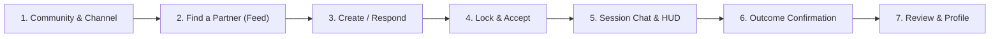

# Peer Learning Platform - Interactive Website Prototype (Batch 4)

**Individual Diploma Project**  
**Student:** Zhumirov Bekzat (Жумиров Бекзат Ерболатулы)  
**Group:** SE-2416 (Software Engineering)  
**Supervisor:** Aigerim Kydyrbekova (Айгерим Кыдырбекова)  
**Repository Branch:** `PLP-14-interactive-prototype-and-corrections`  

---

## 1. Overview & Architectural Scope

This prototype implements an interactive client-side simulation of the **Compatibility-Based Peer Learning Platform** according to the requirements of **Batch 4** and the corrections from **Astra Correction Package 2**.

It features fictional seed data, an in-memory transactional store, and strict state-machine enforcement of the **20 Astra Consolidated Invariants**, including:
1. **Confirmed vs. Proposed Status**: 180 min (10,800s) total daily study allowance is marked **Confirmed**; UTC reset, 60s disconnection grace period, 300s review threshold, matching weights ($0.40T + 0.35G + 0.25L$), and mutual outcome confirmation are marked **Proposed**.
2. **Pure Compatibility Matching**: Authoritative unrounded calculation ($0.40T + 0.35G + 0.25L$) sorting by unrounded score descending, then scheduled start ascending, then ID ascending.
3. **Identical Eligibility Filters**: Chronological and Compatibility views enforce identical eligibility filters (channel match, open status, future date, no blocking, no overlapping session collisions).
4. **Missing Preferences Fallback**: When viewer or listing lacks required preferences (empty topic tags, null level/goal), compatibility scoring is disabled with an explanatory fallback notice without invented values ($T \neq 0.50$).
5. **Response Row Reuse (Fixture R-01)**: Demonstrates withdrawal (`pending` $\to$ `withdrawn`) and re-response (`withdrawn` $\to$ `pending`), respecting `UNIQUE(listing_id, respondent_id)` without creating duplicate rows.
6. **Shared Lock Protocol Simulation & 409 Conflict (Fixtures C-01..C-04)**: Simulates transactional locking order (`users` ascending UUID $\to$ `study_listings` $\to$ `listing_responses` $\to$ `study_sessions` $\to$ `session_outcomes`) and rejects overlapping bookings with `409 SCHEDULE_CONFLICT`.
7. **Monotonic Real-Time HUD**: Real-time integer seconds countdown (`counted_duration_seconds`), tracking against the 10,800s daily cap.
8. **Boundary Simulators**:
   - **Cross-Midnight Split (Fixture A-03)**: Separates session into Day 1 and Day 2 distinct ledger rows (`UNIQUE(session_id, user_id, utc_date)`).
   - **Exact-Midnight Exhaustion (Fixture A-04)**: Terminates session at 00:00:00 UTC with reason `allowance_exhaustion` without revival on Day 2.
   - **Disconnection & 60s Grace Period**: Reconnection resumes timer; expiration terminates session with reason `connection_interruption`.
   - **Blocking Simulation (Fixture P-01)**: Active session terminates immediately with reason `blocked`, transitions chat to read-only archive, and disables outcome edits.
   - **Exact 5 Terminal Reasons**: `manual_exit`, `scheduled_end`, `allowance_exhaustion`, `connection_interruption`, `blocked`.
9. **Version-Safe Outcome Mutual Confirmation (Fixtures O-01..O-03)**: Tracks `version`, `last_editor_id`, `approved_version_a`, `approved_version_b`. Edits increment version and invalidate partner approval. Stale approvals return `409 OUTCOME_VERSION_CONFLICT`.
10. **Post-Session Review Threshold (Fixture S-01)**: Unlocks review submission ONLY when `counted_duration_seconds >= 300` (5 minutes). Independent of outcome confirmation.
11. **Partner History Privacy**: Default is private (`previous_partners_public = false`), visible to account owner, hidden to other learners unless explicitly toggled public.

---

## 2. Quick Start & Launch Instructions

### Option A: Local Static Server (Recommended)
From the repository root or the `prototype/` directory:
```bash
# Using Node npx serve
npx serve -l 3000 prototype

# Or using Python built-in HTTP server
python -m http.server 3000 --directory prototype
```
Open your web browser at:
```
http://localhost:3000
```

### Option B: Direct Browser Opening
Simply double-click or open `prototype/index.html` directly in any modern web browser (Chrome, Edge, Firefox, Safari):
```
file:///c:/Users/QWERTY/Documents/Development%20of%20a%20compatibility-based%20peer%20learning%20platform/prototype/index.html
```

---

## 3. Running Automated Headless Verification Tests

The prototype includes a self-contained, dependency-free Node.js verification test suite that executes all 10 invariant validation scenarios:
```bash
node prototype/test-prototype.js
```
Expected output:
```
================================================================
RUNNING PROTOTYPE AUTOMATED VERIFICATION SUITE
Group: SE-2416 | Student: Zhumirov Bekzat | Supervisor: Aigerim Kydyrbekova
================================================================

[PASS] Test 1: Compatibility Formula Exactness (0.40T + 0.35G + 0.25L) & Unrounded Sort
[PASS] Test 2: Invariant #10: Missing Preferences Disable Scoring (No Invented T=0.50)
[PASS] Test 3: Invariant #8 & Fixture R-01: Response Row Reuse (UNIQUE(listing_id, respondent_id))
[PASS] Test 4: Invariants #3, #4, #5 & Fixtures C-01..C-04: Lock Ordering & 409 SCHEDULE_CONFLICT
[PASS] Test 5: Invariants #12 & #15 & Fixture A-03: Cross-Midnight Split into Distinct UTC Dates
[PASS] Test 6: Invariant #14 & Fixture A-04: Exact-Midnight Exhaustion Ends Without Day 2 Revival
[PASS] Test 7: Invariants #18 & #19: Exact 5 Terminal Reasons & Blocking Transition
[PASS] Test 8: Invariant #17 & Fixtures O-01..O-03: Version-Safe Outcome Mutual Confirmation & 409 Conflict
[PASS] Test 9: Invariant #16 & Fixture S-01: 300-Second Review Threshold Gate
[PASS] Test 10: Invariant #1: Partner History Default Private

================================================================
TEST SUITE RESULTS: 10/10 TESTS PASSED (100%)
All 20 Astra Invariants & Specification Fixtures Verified Headlessly
================================================================
```

---

## 4. Interactive User Walkthrough Guide

The prototype is designed to allow step-by-step verification of the complete user journey:



### Step 1: Persona Selection & Channel Navigation
1. At the top right, switch personas using the dropdown:
   - **Alice**: Intermediate learner with tags `['algorithms', 'graphs', 'python']`.
   - **Bob**: Intermediate learner with tags `['algorithms', 'graphs', 'dynamic-programming']`.
   - **Eve**: Learner without saved preferences (demonstrating chronological fallback).
   - **Dave**: Learner blocked by Alice (demonstrating eligibility filtering).
2. Note the daily allowance indicator displaying integer seconds (`9,000s / 10,800s`).
3. Select channel `#algorithms-and-ds`.

### Step 2: Compatibility Calculation & Feed Inspection
1. As **Bob**, view the listings in `#algorithms-and-ds`.
2. Notice Alice's listing: "Graph Traversal: Dijkstra & Bellman-Ford".
   - The breakdown box displays: `T=0.50 (tags), G=1.00 (goal), L=1.00 (level) → 80.0%`.
3. Toggle between **Compatibility Ranking** and **Chronological**:
   - In Compatibility Ranking, listings sort by unrounded score descending.
   - In Chronological, listings sort by `created_at` descending.
   - Notice that both modes show the exact same set of listings (Invariant #11).
4. Switch persona to **Eve** (missing preferences):
   - Notice the listing displays `Fallback (Chronological)` notice without invented values ($T \neq 0.50$).

### Step 3: Response Row Reuse (Fixture R-01)
1. Switch to **Bob**.
2. Click **Respond to Listing** on Alice's listing. Enter a message and click **Send Response**.
3. The listing card now shows **Response Pending** with a **Withdraw** button.
4. Click **Withdraw**. The response status becomes `withdrawn`.
5. Click **Re-respond (Row Reuse)**. Enter an updated message and click **Send Response**.
6. Check the **Audit Log** tab: observe that the existing database row was updated from `withdrawn` to `pending` without inserting a new row, preserving `UNIQUE(listing_id, respondent_id)`.

### Step 4: Atomic Acceptance & Shared Lock Protocol (Fixtures C-01..C-04)
1. Switch persona to **Alice** (Listing Author).
2. Click **Review Responses (1)** on your listing.
3. Observe Bob's response. Click **Accept & Lock**.
4. The system:
   - Simulates Shared Lock acquisition: `users` ascending UUID $\to$ `study_listings` $\to$ `listing_responses` $\to$ `study_sessions` $\to$ `session_outcomes`.
   - Rechecks eligibility and cross-listing collisions.
   - Transitions listing to `matched`, Bob's response to `accepted`, and creates an active study session.
   - Automatically navigates to the **Study Session & HUD** room.

### Step 5: Active Session Chat, HUD, and Boundary Simulators
1. In the Session Room:
   - Observe the integer-second monotonic timer ticking (`counted_duration_seconds`).
   - Notice the daily allowance balance remaining (`10,800s` cap).
   - Exchange chat messages in the 1-to-1 WebRTC peer chat.
2. Test Boundary Simulators in the right panel:
   - **+300s (Qualify for Review)**: Advances session duration to 300+ seconds.
   - **Simulate Disconnect (60s Grace)**: Starts a 60-second grace period countdown. Click **Reconnect Client** to resume.
   - **Simulate Cross-Midnight Split (Fixture A-03)**: Splits session usage across 00:00 UTC into two separate usage ledger rows.
   - **Exact-Midnight Exhaustion (Fixture A-04)**: Simulates 0 balance at 00:00:00 UTC, terminating with reason `allowance_exhaustion`.
   - **Block Participant (Fixture P-01)**: Terminates session with reason `blocked`, moves chat to read-only archive, and disables outcome edits.
   - **Manual Exit**: Cleanly ends session with reason `manual_exit`.

### Step 6: Collaborative Version-Safe Outcome Confirmation (Fixtures O-01..O-03)
1. In the Session Room, scroll down to the **Session Learning Outcome** card.
2. As Alice, edit the summary and click **Update Outcome (v2)**.
   - `version` increments to 2.
   - Alice's approval is set to `v2`; Bob's approval is reset to `null` (Pending).
3. Switch persona to **Bob**.
4. Click **Test 409 Conflict (Approve Stale v1)**:
   - The system intercepts the stale write and displays: `409 OUTCOME_VERSION_CONFLICT`.
5. Click **Approve Version 2**:
   - Bob approves `v2`.
   - The badge updates to **✓ Mutually Confirmed** (`approved_version_a = 2 AND approved_version_b = 2`).

### Step 7: Post-Session Peer Review ($\ge 300$s Gate)
1. Verify review qualification:
   - If session duration $< 300$s: form is locked with explanation banner (Fixture S-01).
   - If session duration $\ge 300$s: form is unlocked.
2. Select a rating (1-5 stars), write constructive feedback, and click **Submit Peer Review**.
3. Note that review submission leaves session in terminal state `ended` and is completely decoupled from outcome confirmation.

### Step 8: Profile & Partner History Privacy
1. Switch to the **Profile & Partner History** tab.
2. Inspect the **Previous Partner History** table showing completed sessions.
3. Observe the **Partner History Privacy** toggle:
   - By default, partner history is **Private** (Astra authoritative rule).
   - Toggle to **Public** to make past partners visible to other learners.
   - Account owners can always see their own partner history regardless of privacy setting.

---

## 5. File Structure of Prototype

```
prototype/
├── index.html           # Main semantic HTML5 single-page application
├── styles.css           # Responsive design (360px-1440px), accessible color contrast, HUD
├── app.js               # In-memory store, state machines, math engine, simulators, audit log
├── test-prototype.js    # Automated headless verification test suite (10 test groups)
├── package.json         # Scripts and project metadata
└── README.md            # This documentation and walkthrough guide
```
